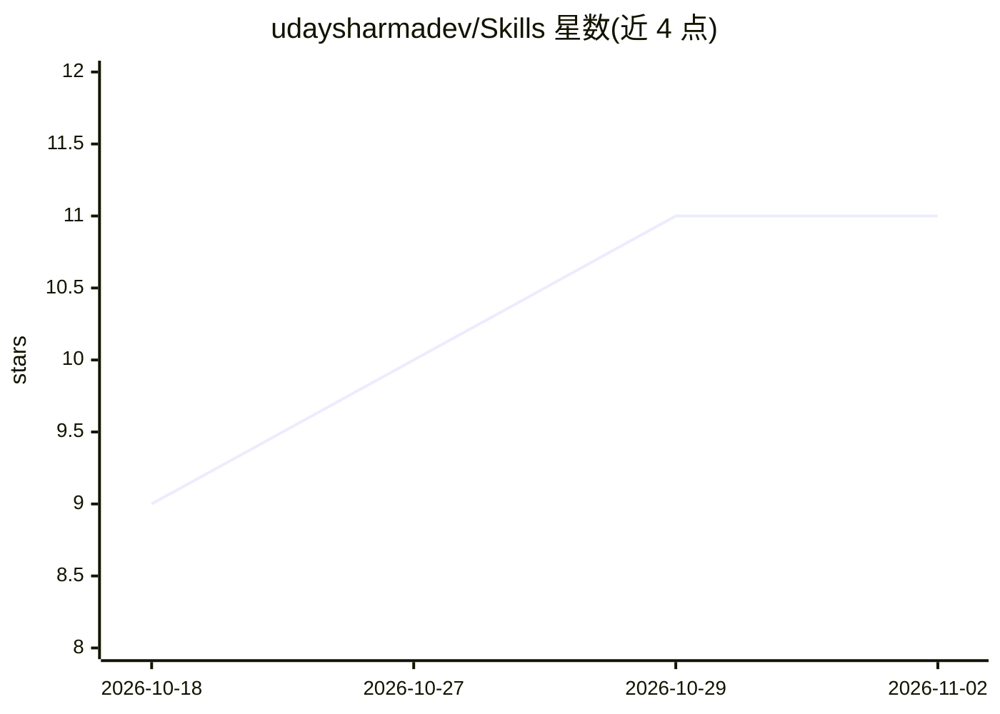

# udaysharmadev/Skills

⭐ 11 · Python · MIT · 推送 2026-10-26 · [GitHub](https://github.com/udaysharmadev/Skills) · 个人维护

**面向 AI 编码 agent 的 28 个工程技能包，覆盖构思到上线**

由 28 个按职责划分的 Agent Skills（SKILL.md 文件夹）组成的技能包，供 AI 编码 agent 按需加载使用：从构思压测、仓库理解、计划制定，到后端契约、UI 打磨、调试、性能测量、安全加固、清理与部署验证，各技能自带工作流与验证约定，并声明适用/不适用条件。遵循 Agent Skills 规范的渐进式披露（按需加载 SKILL.md 与引用资源）。核心为 Markdown 与标准库小工具，可通过 npx skills 安装全部或单个技能，另附研究溯源索引与升级台账。

## 筛选速览

| 维度 | 判定 | 备注 |
|---|---|---|
| AI 角色 | `ai-ecosystem` | LLM/agent 周边工具 |
| 许可风险 | `permissive` | MIT |
| 部署形态 | `library` | 以包/库形式分发 |
| 模型依赖 | — | README 未给出锁定关系 |
| 硬件要求 | — | 无带数字的原话,不猜 |
| 安装摩擦 | `low` | 无编译、无系统依赖或容器化 |
| 成熟度 | — | 结构信号不足 |

## 能力要点

- 28 个单一职责技能，各带验证约定与停止条件
- 渐进式披露：按需加载 SKILL.md 与参考资源
- 每个技能有独立研究溯源记录与升级台账
- 单个技能文件夹可独立复制使用，无仓库内隐式依赖

## 适用场景

- 让 AI 编码 agent 在编码各阶段调用专门技能执行工作流
- 为调试、性能、安全审查等任务加载带验证步骤的技能
- 安装单个技能到现有 agent 项目中配合使用

## 场景标签

 · 领域:开发者工具/AI 编码

## 证据(README 行号)

> L66: Twenty-eight skills do not become one enormous system prompt. Discovery sees
> L67: compact names and descriptions; the relevant `SKILL.md` loads on demand; only
> L68: its necessary references or helper scripts load after that. This follows the

## 星数曲线

2026-10-18 9 → 2026-11-02 11（+2）

---
*卡片 v1 · prompt 1.4 · 生成 2026-11-02 · 置信度 high · 依据 README sha `b3f2c29f7fe8` · [字段定义](../../DATASET.md)*
