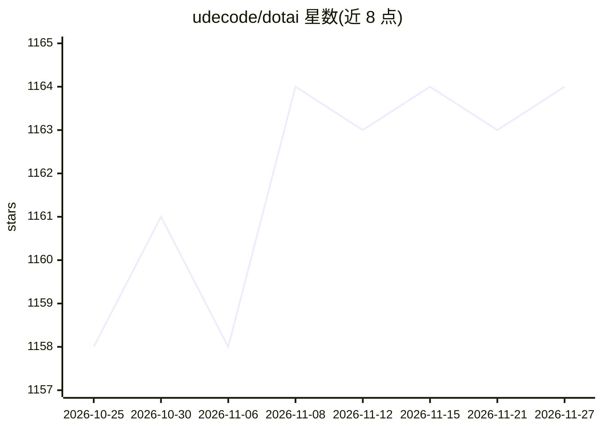

# udecode/dotai

⭐ 1,164 · JavaScript · 推送 2026-11-26 · [GitHub](https://github.com/udecode/dotai) · 组织维护

**面向 coding agent 的共享技能集：审计、视频、同步等复用方法**

udecode 的 ustack 仓库提供 pstack 插件未覆盖的共享 agent 技能：测试审计（test-audit）、技能与覆盖审计（skill-audit）、视频片段与转录，以及 pstack 的安装同步（sync-pstack）。技能通过 Skills CLI 安装并可指定目标 agent；仓库约定 skills/ 目录只放可复用方法，禁止包含产品名、私路径与凭据；配套 validate-skills 与 build-workflow.mjs 脚本做结构校验与目录再生成。

## 筛选速览

| 维度 | 判定 | 备注 |
|---|---|---|
| AI 角色 | `ai-knowledge` | 知识聚合/清单类 |
| 许可风险 | `none` | — |
| 部署形态 | `library` | 以包/库形式分发 |
| 模型依赖 | — | README 未给出锁定关系 |
| 硬件要求 | — | 无带数字的原话,不猜 |
| 安装摩擦 | `low` | 无编译、无系统依赖或容器化 |
| 成熟度 | — | 结构信号不足 |

## 能力要点

- test-audit、skill-audit、sync-pstack 等共享技能
- Skills CLI 一条命令按技能与 agent 安装（项目级/全局）
- validate-skills 校验 frontmatter、体量预算并运行技能测试
- build-workflow.mjs 再生成 SKILLS.md 并解析依赖与本地引用

## 适用场景

- 给 Codex / Claude Code 等 agent 安装可复用工程方法技能
- 为多个项目统一 pstack 插件配置与覆盖块
- 在团队仓库中隔离私有信息后再共享 agent 技能

## 场景标签

`Agent 框架` · 领域:Agent 开发

## 证据(README 行号)

> L3: Shared skills that the pstack plugin does not cover: test audits (`test-audit`, adapted from openclaw's), skill and 
> L22: Install a skill with the Skills CLI, naming the skill and each agent, for example `npx skills add udecode/ustack --

## 星数曲线

2026-10-25 1,158 → 2026-11-27 1,164（+6）

---
*卡片 v1 · prompt 1.4 · 生成 2026-11-27 · 置信度 mid · 依据 README sha `3c36a7096461` · [字段定义](../../DATASET.md)*
