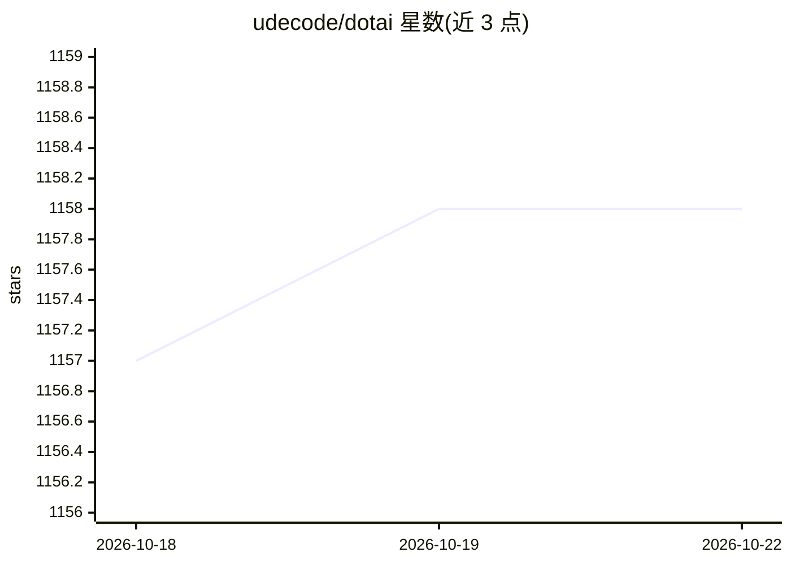

# udecode/dotai

⭐ 1,158 · JavaScript · 推送 2026-10-21 · [GitHub](https://github.com/udecode/dotai) · 组织维护

**面向编码 agent 的共享技能集合（测试审计、pstack 同步等）**

udecode 维护的 agent 技能仓库，提供 pstack 插件未覆盖的共享技能：test-audit（改编自 openclaw）、截图走查与视频转录、sync-pstack（pstack 项目初始化与技能漂移审计）、passwords（1Password 无人值守登录与新 Mac 配置）。工程方法论引用上游 pstack-claude 插件但不复制其源码。通过 Skills CLI（npx skills add）按技能名与 agent 安装，支持 codex、claude-code 等 agent，默认项目级安装。仓库含校验脚本生成 SKILLS.md 清单与 workflow manifest。

## 筛选速览

| 维度 | 判定 | 备注 |
|---|---|---|
| AI 角色 | `ai-ecosystem` | LLM/agent 周边工具 |
| 许可风险 | `none` | — |
| 部署形态 | `library` | 以包/库形式分发 |
| 模型依赖 | — | README 未给出锁定关系 |
| 硬件要求 | — | 无带数字的原话,不猜 |
| 安装摩擦 | `low` | 无编译、无系统依赖或容器化 |
| 成熟度 | — | 结构信号不足 |

## 能力要点

- test-audit、screenshot walkthrough、sync-pstack、passwords 四类技能
- npx skills add 按技能与 agent（codex/claude-code）安装
- build-workflow.mjs 生成 SKILLS.md 清单、校验依赖与文件校验和
- 上游 pstack 技能不 vendored，按清单固定安装命令

## 适用场景

- 为编码 agent 补充测试审计与工作流技能
- 在多个项目间统一 pstack 配置并审计技能漂移
- 无人值守 1Password 登录与新 Mac 初始化

## 场景标签

 · 领域:开发者工具/agent 技能

## 证据(README 行号)

> L22: Install a skill with the Skills CLI, naming the skill and each agent, for example `npx skills add udecode/dotai --s
> L3: Shared skills that the pstack plugin does not cover: test audits (`test-audit`, adapted from openclaw's), screenshot

## 星数曲线

2026-10-18 1,157 → 2026-10-22 1,158（+1）

---
*卡片 v1 · prompt 1.4 · 生成 2026-10-21 · 置信度 high · 依据 README sha `32134f692ea1` · [字段定义](../../DATASET.md)*
