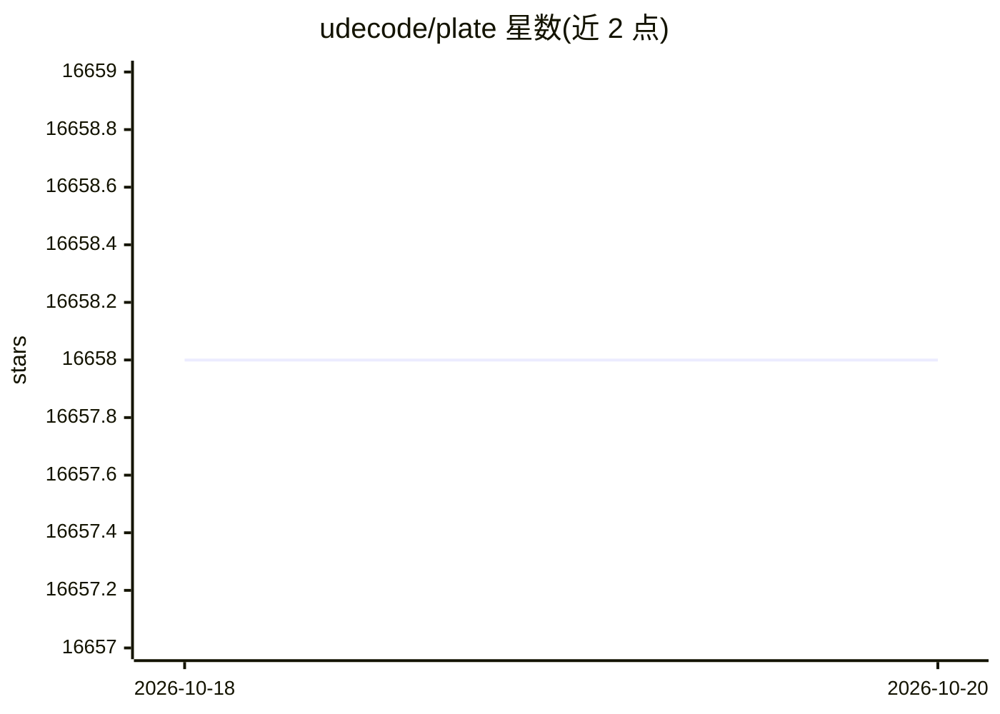

# udecode/plate

⭐ 16,658 · TypeScript · NOASSERTION · 推送 2026-10-19 · [GitHub](https://github.com/udecode/plate) · [官网](https://platejs.org) · 组织维护 · 中文 README

**为 React 开发者提供带 AI 能力的富文本编辑器框架**

基于 Slate 的 React 富文本编辑器框架，README 提供三种起步模板：Notion 风格模板（含插件与 AI）、playground 模板、最小模板。核心机制通过插件体系组织功能，文档站与中文文档、Discord 中文频道支持中文使用者。README 本身内容简短，功能细节需查阅文档。

## 筛选速览

| 维度 | 判定 | 备注 |
|---|---|---|
| AI 角色 | `ai-ecosystem` | LLM/agent 周边工具 |
| 许可风险 | `none` | NOASSERTION |
| 部署形态 | `None` |  |
| 模型依赖 | — | README 未给出锁定关系 |
| 硬件要求 | — | 无带数字的原话,不猜 |
| 安装摩擦 | `low` | 无编译、无系统依赖或容器化 |
| 成熟度 | — | 结构信号不足 |

## 动量与使用信号

- 维护:`active` — 距上次 push 0.9 天,年发版 100,241 位贡献者
- 涨星:近 1 天 **+3**(自 20261016 起算)

## 能力要点

- 基于 Slate 的 React 富文本编辑器框架
- 提供 Notion 风格、playground、minimal 三种模板
- 模板可组合插件与 AI 能力
- 提供中文文档与 Discord 中文频道

## 适用场景

- 在 React 应用中搭建所见即所得编辑器
- 参照 Notion 风格模板快速搭建文档类产品编辑器
- 中文团队查阅中文文档接入编辑器

## 场景标签

 · 领域:前端/编辑器组件

## 证据(README 行号)

> L1: Plate
> L11: |Option|Plate|Plugins|AI|Backend|
> L25: ## 中文文档

## 星数曲线

2026-10-18 16,658 → 2026-10-20 16,658（+0）

---
*卡片 v1 · prompt 1.4 · 生成 2026-10-18 · 置信度 high · 依据 README sha `391a4dd90d13` · [字段定义](../../DATASET.md)*
