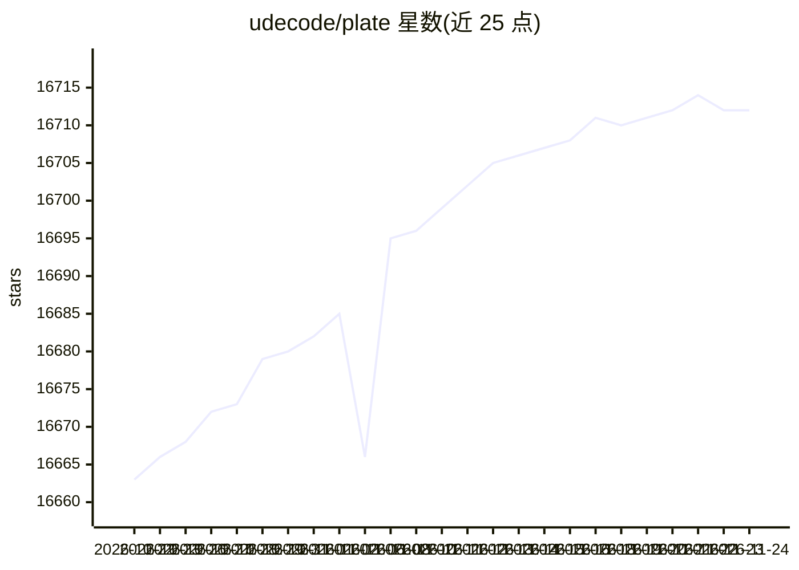

# udecode/plate

⭐ 16,712 · TypeScript · NOASSERTION · 推送 2026-11-22 · [GitHub](https://github.com/udecode/plate) · [官网](https://platejs.org) · 组织维护 · 中文 README

**React 富文本编辑器框架，含 AI 插件与 shadcn/ui 集成**

基于 Slate 的富文本编辑器框架，面向 React 开发者，与 shadcn/ui 集成。README 提供三种起步模板：Notion 风格模板（含插件与 AI）、playground 模板、最小模板；文档站提供更多说明，另维护中文文档、Discord 中文频道与中文贡献指南。可见 README 未展开具体 AI 功能细节，需查阅文档获取。

## 筛选速览

| 维度 | 判定 | 备注 |
|---|---|---|
| AI 角色 | `ai-enhanced` | 去掉 AI 部分产品仍成立 |
| 许可风险 | `none` | NOASSERTION |
| 部署形态 | `None` |  |
| 模型依赖 | — | README 未给出锁定关系 |
| 硬件要求 | — | 无带数字的原话,不猜 |
| 安装摩擦 | `low` | 无编译、无系统依赖或容器化 |
| 成熟度 | — | 结构信号不足 |

## 动量与使用信号

- 维护:`active` — 距上次 push 0.9 天,年发版 100,241 位贡献者
- 涨星:近 1 天 **+3**(自 20261016 起算)

## 能力要点

- 提供 Notion 风格、playground、minimal 三种起步模板
- Notion 风格与 playground 模板包含 AI 能力
- 与 shadcn/ui 集成
- 提供中文文档、Discord 中文频道与中文贡献指南

## 适用场景

- 在 React 应用中搭建富文本编辑器
- 用 Notion 风格模板快速获得带 AI 与后端的编辑器
- 需要 shadcn/ui 风格编辑器组件的项目

## 场景标签

`AI 写作` · 领域:内容生成

## 证据(README 行号)

> L9: |Option|Plate|Plugins|AI|Backend|
> L23: ## 中文文档

## 星数曲线

2026-10-22 16,663 → 2026-11-24 16,712（+49）

---
*卡片 v1 · prompt 1.4 · 生成 2026-11-22 · 置信度 mid · 依据 README sha `faf51a40471d` · [字段定义](../../DATASET.md)*
