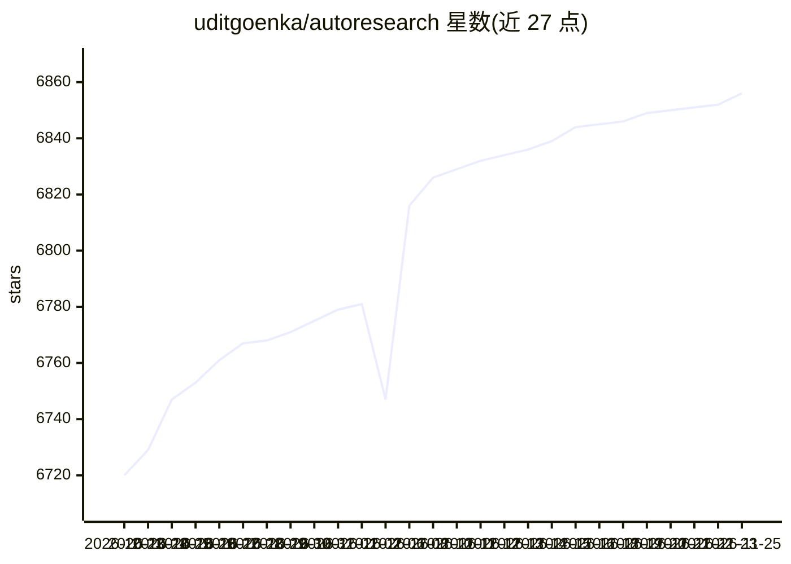

# uditgoenka/autoresearch

⭐ 6,856 · Shell · MIT · 推送 2026-10-31 · [GitHub](https://github.com/uditgoenka/autoresearch) · [官网](https://udit.co/projects/autoresearch) · 个人维护

**给 Claude Code 等 agent 加自动迭代优化循环的技能**

以 Claude Code Skill 形式提供的自主改进循环：设定目标与可机械度量的指标后，按修改→验证→保留/回滚的方式反复迭代，进度写入 TSV 日志，以 git 提交记录实验。提供 14 个子命令（debug、fix、security、ship、plan 等）与编排器模式，可将自然语言目标转为循环直到谓词满足。支持 Claude Code、OpenCode、OpenAI Codex、pi、Muse 五种宿主；hook 护栏仅在 Claude Code 与 pi 上提供。默认有迭代次数上限，无限迭代需显式开启。

## 筛选速览

| 维度 | 判定 | 备注 |
|---|---|---|
| AI 角色 | `ai-ecosystem` | LLM/agent 周边工具 |
| 许可风险 | `permissive` | MIT |
| 部署形态 | `library` | 以包/库形式分发 |
| 模型依赖 | — | README 未给出锁定关系 |
| 硬件要求 | — | 无带数字的原话,不猜 |
| 安装摩擦 | `low` | 无编译、无系统依赖或容器化 |
| 成熟度 | — | 结构信号不足 |

## 能力要点

- modify→verify→keep/discard 的自动迭代循环，失败改动自动回滚
- 14 个子命令与自然语言目标的编排器模式（v2.2.0）
- 9 类 hook 护栏：隐私屏蔽、危险命令拦截、上下文注入等
- 卡 plateaus 时 fork 新分支并保留最优提交（fork-and-flush）

## 适用场景

- 通宵自动提升测试覆盖率或优化构建指标
- 按假设迭代地 hunt 并修复代码库中的 bug
- 发布前做 STRIDE/OWASP 安全审计与回归门禁
- 在模糊目标下让 agent 自主编排多轮改进

## 场景标签

`编码 Agent` `网络安全` · 领域:编码与开发

## 证据(README 行号)

> L3: **Turn Claude Code, OpenCode, OpenAI Codex, pi, or Muse into a relentless improvement engine.**
> L22: **Supports Claude Code, OpenCode, OpenAI Codex, pi, and Muse for the core skill, bundled runtime, installation, and
> L125: |`/autoresearch`|**Classic:** Core iterate loop: modify → verify → keep/discard · **Orchestrator:** free-form goal

## 星数曲线

2026-10-23 6,720 → 2026-11-25 6,856（+136）

---
*卡片 v1 · prompt 1.4 · 生成 2026-11-22 · 置信度 high · 依据 README sha `47eda1373139` · [字段定义](../../DATASET.md)*
