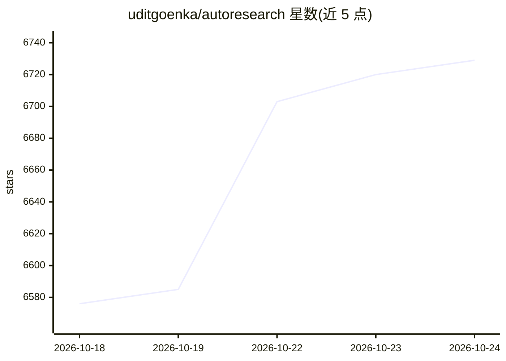

# uditgoenka/autoresearch

⭐ 6,747 · Shell · MIT · 推送 2026-08-12 · [GitHub](https://github.com/uditgoenka/autoresearch) · [官网](https://udit.co/projects/autoresearch) · 个人维护

**让 Claude Code/OpenCode/Codex 自主迭代改进代码的技能包**

基于 Karpathy autoresearch 思路的 Claude Code 技能包，兼容 OpenCode 与 OpenAI Codex：提供 /autoresearch 及 13 个子命令，按 Goal→Modify→Verify→Keep/Discard 循环迭代，失败自动回滚，git 作为实验记忆，进度以 TSV 记录。v2.2 支持自然语言目标的自主编排。附 Claude Code 专属 hook 防护（阻断危险命令、隐私文件读取等），OpenCode/Codex 不含 hook。通过 npx skills、plugin 市场、git clone 手动复制或脚本安装。

## 筛选速览

| 维度 | 判定 | 备注 |
|---|---|---|
| AI 角色 | `ai-ecosystem` | LLM/agent 周边工具 |
| 许可风险 | `permissive` | MIT |
| 部署形态 | `library` | 以包/库形式分发 |
| 模型依赖 | locked-api |  |
| 硬件要求 | — | 无带数字的原话,不猜 |
| 安装摩擦 | `low` | 无编译、无系统依赖或容器化 |
| 成熟度 | — | 结构信号不足 |

## 能力要点

- 14 个命令覆盖迭代改进、调试、修复、安全审计、发布等场景
- Modify→Verify→Keep/Discard 循环，失败自动回滚，git 作为实验记忆
- 自然语言目标的自主编排器（v2.2）
- 8 个默认开启的 hook 防护（仅 Claude Code）

## 适用场景

- 设定指标让 agent 通宵自动迭代提升测试覆盖率或减小包体积
- 让 agent 按假设迭代排查 bug 并自动修复
- 在发布前做 STRIDE/OWASP 安全审计与回归门禁

## 场景标签

`编码 Agent` · 领域:编码与开发

## 证据(README 行号)

> L3: **Turn Claude Code, OpenCode, or OpenAI Codex into a relentless improvement engine.**
> L21: **Supports Claude Code, OpenCode, and OpenAI Codex for the core skill, bundled runtime, installation, and verificat
> L122: |`/autoresearch`|**Classic:** Core iterate loop: modify → verify → keep/discard · **Orchestrator:** free-form goal

## 星数曲线

2026-10-18 6,576 → 2026-10-24 6,729（+153）

---
*卡片 v1 · prompt 1.4 · 生成 2026-10-20 · 置信度 high · 依据 README sha `9261f7cb5dad` · [字段定义](../../DATASET.md)*
