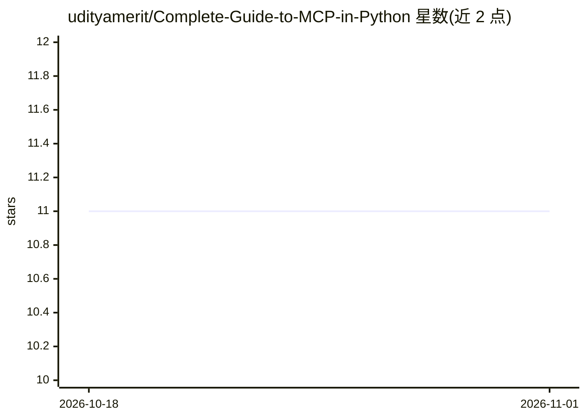

# udityamerit/Complete-Guide-to-MCP-in-Python

⭐ 11 · HTML · MIT · 推送 2026-07-13 · [GitHub](https://github.com/udityamerit/Complete-Guide-to-MCP-in-Python) · [官网](https://udityamerit.github.io/MCP-Server/) · 个人维护

**Python 构建 MCP 服务器与客户端的从入门到进阶教程仓库**

面向 Python 开发者的 MCP（Model Context Protocol）学习课程仓库：以 Python SDK 为主线，按章节覆盖 MCP 架构、Tools/Resources/Prompts、STDIO 与 Streamable HTTP 传输、服务器部署发布（AWS EC2、Nginx、uvx）、OpenAI Function Calling 集成与多服务器编排，并含 Chess.com 数据服务器与基于 OpenAI Vector Stores 的记忆跟踪器两个端到端项目。运行方式为克隆仓库、建虚拟环境、安装依赖后按章节目录执行，各章节自带 README。仓库不含独立产品，属教学代码集合。

## 筛选速览

| 维度 | 判定 | 备注 |
|---|---|---|
| AI 角色 | `ai-knowledge` | 知识聚合/清单类 |
| 许可风险 | `permissive` | MIT |
| 部署形态 | `library` | 以包/库形式分发 |
| 模型依赖 | — | README 未给出锁定关系 |
| 硬件要求 | — | 无带数字的原话,不猜 |
| 安装摩擦 | `low` | 无编译、无系统依赖或容器化 |
| 成熟度 | — | 结构信号不足 |

## 能力要点

- 11 章课程覆盖 MCP 架构、开发、部署与发布全流程
- 端到端项目：Chess.com 数据服务器与 OpenAI Vector Stores 记忆跟踪器
- 多 MCP 服务器编排与 MCP Inspector 调试实践

## 适用场景

- 从零学习用 Python 开发 MCP 服务器与客户端
- 学习将 MCP 工具接入 OpenAI Function Calling 与 Claude Desktop
- 参考 MCP 服务器在云端部署与发布的做法

## 场景标签

`教程课程` · 领域:学习与行业

## 证据(README 行号)

> L65: This repository is a complete beginner-to-advanced guide focused on:
> L125: Explore the step-by-step curriculum of the complete MCP course:

## 星数曲线

2026-10-18 11 → 2026-11-01 11（+0）

---
*卡片 v1 · prompt 1.4 · 生成 2026-11-01 · 置信度 mid · 依据 README sha `c9f8f89f7c25` · [字段定义](../../DATASET.md)*
