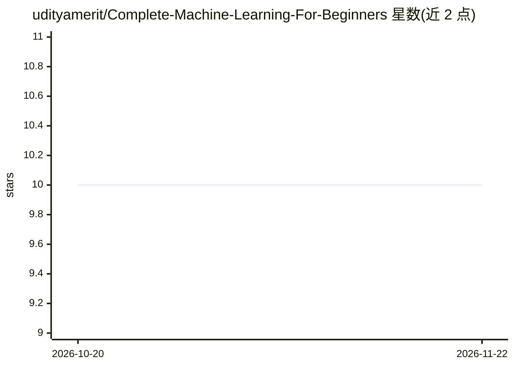

# udityamerit/Complete-Machine-Learning-For-Beginners

⭐ 10 · Jupyter Notebook · MIT · 推送 2026-06-02 · [GitHub](https://github.com/udityamerit/Complete-Machine-Learning-For-Beginners) · 个人维护

**机器学习初学者的理论+Jupyter 实操学习路线图**

以路线图形式组织的机器学习教学仓库：理论 PDF 与 Jupyter Notebook 实操代码结合，覆盖从统计学基础到回归模型、特征工程、探索性数据分析及部署流程；使用真实数据集（葡萄酒、机票价格、Google Play 商店数据）并附小型项目。面向学生、自学者及需要复习或进阶的从业者，通过 git clone 后安装 requirements.txt 即可本地运行各笔记本。

## 筛选速览

| 维度 | 判定 | 备注 |
|---|---|---|
| AI 角色 | `ai-knowledge` | 知识聚合/清单类 |
| 许可风险 | `permissive` | MIT |
| 部署形态 | `library` | 以包/库形式分发 |
| 模型依赖 | — | README 未给出锁定关系 |
| 硬件要求 | — | 无带数字的原话,不猜 |
| 安装摩擦 | `low` | 无编译、无系统依赖或容器化 |
| 成熟度 | — | 结构信号不足 |

## 能力要点

- 理论 PDF 与 Jupyter Notebook 代码实现结合
- 覆盖缺失值处理、不平衡数据、异常值等特征工程主题
- 线性/多项式/岭回归/lasso 等回归模型完整笔记本
- 基于真实数据集的 EDA 与小型项目

## 适用场景

- 系统入门机器学习并跟练 Jupyter 笔记本
- 复习回归模型与特征工程知识点
- 用真实数据集练习 EDA 与数据预处理

## 场景标签

`教程课程` · 领域:学习与行业

## 证据(README 行号)

> L9: This repository is structured as a **complete ML roadmap** combining theory (PDFs) with hands-on coding (Jupyter Not
> L15: - ✅ Beginner to Intermediate level ML roadmap

## 星数曲线

2026-10-20 10 → 2026-11-22 10（+0）

---
*卡片 v1 · prompt 1.4 · 生成 2026-11-19 · 置信度 high · 依据 README sha `d70b9aeab18a` · [字段定义](../../DATASET.md)*
