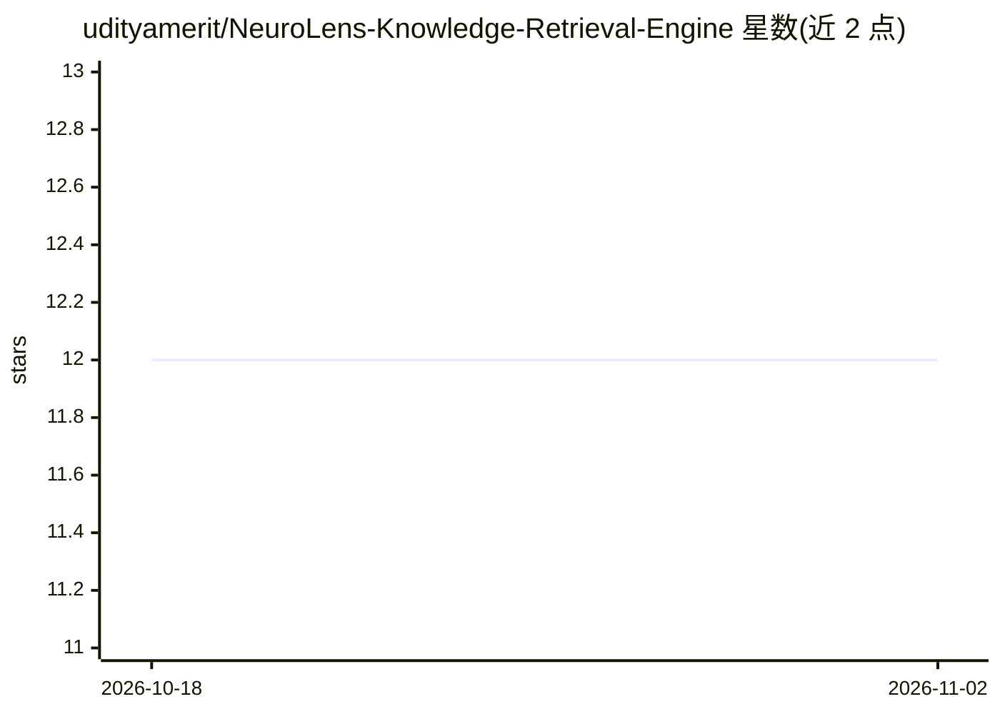

# udityamerit/NeuroLens-Knowledge-Retrieval-Engine

⭐ 12 · JavaScript · MIT · 推送 2026-09-10 · [GitHub](https://github.com/udityamerit/NeuroLens-Knowledge-Retrieval-Engine) · [官网](https://udityamerit.github.io/NeuroLens-Knowledge-Retrieval-Engine/) · 个人维护

**双架构文档 RAG 问答平台：浏览器端或 FastAPI+FAISS 后端**

Document RAG 问答应用，提供两种执行模式：零后端的浏览器端独立模式（PDF.js 解析、Mammoth DOCX 提取、BM25 多文档公平轮转检索、IndexedDB 持久化，可部署到 GitHub Pages），以及 FastAPI + SentenceTransformers(all-MiniLM-L6-v2) + FAISS 的全栈模式做稠密语义检索。LLM 接入 Groq 免费模型（默认 qwen）、OpenAI、Hugging Face 端点；支持 KaTeX 数学渲染、语音输入输出（ElevenLabs/Web Speech）、摄像头 OCR。API key 存储于浏览器本地。

## 筛选速览

| 维度 | 判定 | 备注 |
|---|---|---|
| AI 角色 | `ai-native` | 本体是模型或模型工具 |
| 许可风险 | `permissive` | MIT |
| 部署形态 | `library` | 以包/库形式分发 |
| 模型依赖 | locked-api |  |
| 硬件要求 | — | 无带数字的原话,不猜 |
| 安装摩擦 | `low` | 无编译、无系统依赖或容器化 |
| 成熟度 | — | 结构信号不足 |

## 能力要点

- 浏览器端零后端模式：PDF/DOCX 解析、BM25 检索、IndexedDB 持久化全在客户端
- 多文档公平轮转检索与动态上下文配额，避免长文档淹没短文档
- KaTeX 完整 LaTeX 数学渲染（含文档预览内公式）
- 双 TTS 引擎（ElevenLabs + Web Speech 回退）与摄像头 OCR

## 适用场景

- 上传多个 PDF/DOCX 文档做跨文档问答与摘要对比
- 无后端静态托管（GitHub Pages）下运行本地知识库问答
- 含数学公式的学术文档问答与朗读

## 场景标签

`文档问答` · 领域:知识与检索

## 证据(README 行号)

> L19: **NeuroLens** is a high-performance Document Retrieval-Augmented Generation (RAG) platform designed to ingest, inde
> L22: 1. **Zero-Backend Standalone Mode (Browser-Native)**: Runs 100% inside your web browser (ideal for GitHub Pages / s
> L23: 2. **Full-Stack Hybrid Mode (FastAPI + FAISS)**: High-throughput Python server leveraging SentenceTransformers (`al

## 星数曲线

2026-10-18 12 → 2026-11-02 12（+0）

---
*卡片 v1 · prompt 1.4 · 生成 2026-10-31 · 置信度 high · 依据 README sha `1ceaf8ddc684` · [字段定义](../../DATASET.md)*
