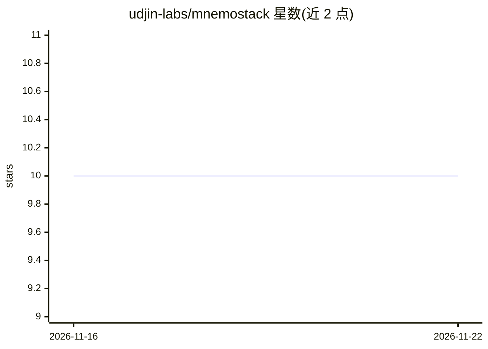

# udjin-labs/mnemostack

⭐ 10 · Python · Apache-2.0 · 推送 2026-11-19 · [GitHub](https://github.com/udjin-labs/mnemostack) · 个人维护

**为 AI agent 提供持久化混合记忆与检索后端**

mnemostack 是一个自托管的 agent 记忆与检索层：摄取笔记、消息、文档或应用事件，通过向量、词法、时间与可选图检索的组合混合召回，支持 RRF 融合、重排序、token 预算、事实失效与 as_of 有效性读取，并提供服务密钥、租户隔离、配额与导出等运维控制。通过 Python SDK、CLI、HTTP API 与 MCP server 四种接口暴露同一后端；agent 集成自行决定何时捕获或召回上下文。3.0 起要求 Qdrant 1.20+ 并改为服务端 BM25。

## 筛选速览

| 维度 | 判定 | 备注 |
|---|---|---|
| AI 角色 | `ai-ecosystem` | LLM/agent 周边工具 |
| 许可风险 | `permissive` | Apache-2.0 |
| 部署形态 | `self-host` | docker 或自建部署 |
| 模型依赖 | local-ok | 支持本地模型 |
| 硬件要求 | — | 无带数字的原话,不猜 |
| 安装摩擦 | `low` | 无编译、无系统依赖或容器化 |
| 成熟度 | — | 结构信号不足 |

## 能力要点

- 向量 + BM25 + 时间 + 可选图的混合检索，RRF 融合与重排序
- 记忆生命周期控制：失效、有效区间、as_of 读取、引用解析
- 四种接口：Python SDK、CLI、HTTP API、MCP server
- 服务化运维：租户隔离、配额、计量、导出与下线

## 适用场景

- 让 agent 在重启后保留并检索跨会话上下文
- 为多个应用或 agent 提供租户隔离的共享记忆服务
- 基于文档做有出处的 RAG 回答
- 对个人消息归档建立多客户端可查询的知识库

## 场景标签

`Agent 记忆` `RAG` `知识库管理` · 领域:Agent 开发

## 证据(README 行号)

> L12: The Python SDK, CLI, HTTP API, and MCP server are interfaces to the same memory and retrieval components. Agent int
> L85: mnemostack is an independent memory and retrieval layer. You can embed its components in an application, expose the

## 星数曲线

2026-11-16 10 → 2026-11-22 10（+0）

---
*卡片 v1 · prompt 1.4 · 生成 2026-11-20 · 置信度 high · 依据 README sha `1e8e59ffff86` · [字段定义](../../DATASET.md)*
