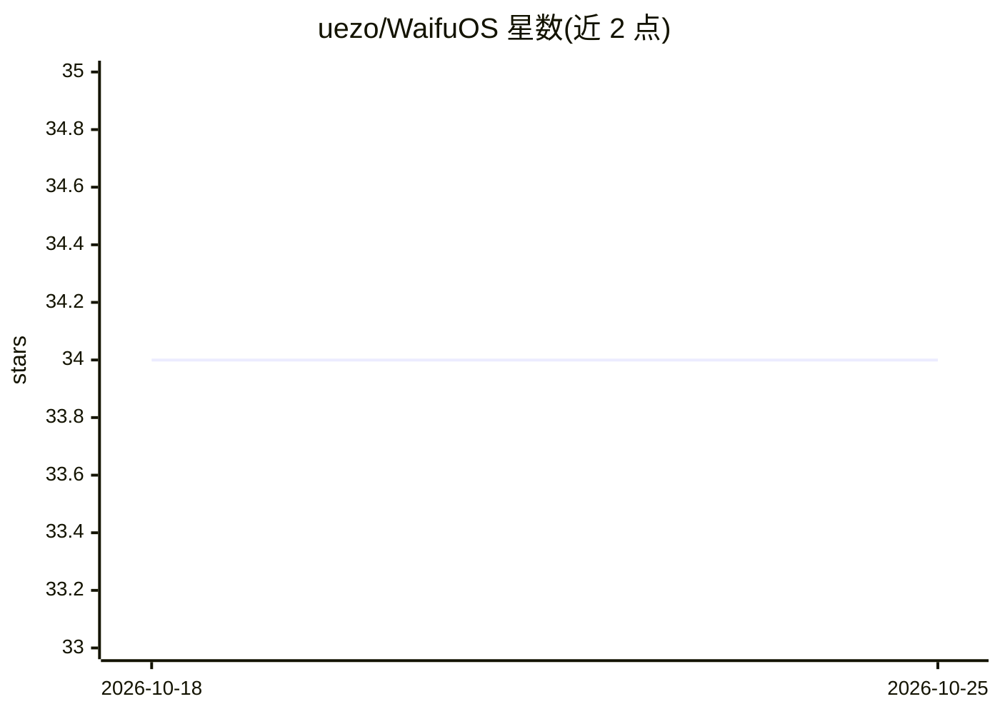

# uezo/WaifuOS

⭐ 34 · Python · Apache-2.0 · 推送 2025-12-07 · [GitHub](https://github.com/uezo/WaifuOS) · 个人维护

**创建 AI 虚拟伴侣的全栈软件套件，含语音与多渠道接入**

自托管的一体化 AI 伴侣套件：基于 Docker Compose 组合角色 LLM、语音合成、数据库与基础设施，用户通过 CLI 以问答方式创建角色（名称、性格描述、语音服务与音色），角色按日程生活并保留共享记忆。支持 VOICEVOX/sbv2/Azure/OpenAI 多种语音服务，提供类 OpenAI 的流式 API（SSE，STT→LLM→TTS）与实时 WebSocket 语音对话 API，可接入 Web、3D 头像（ChatdollKit）、LINE Bot 等前端。OpenAI API key 为必需配置，可选用 Langfuse 做可观测性。

## 筛选速览

| 维度 | 判定 | 备注 |
|---|---|---|
| AI 角色 | `ai-native` | 本体是模型或模型工具 |
| 许可风险 | `permissive` | Apache-2.0 |
| 部署形态 | `self-host` | docker 或自建部署 |
| 模型依赖 | — | README 未给出锁定关系 |
| 硬件要求 | — | 无带数字的原话,不猜 |
| 安装摩擦 | `low` | 无编译、无系统依赖或容器化 |
| 成熟度 | — | 结构信号不足 |

## 能力要点

- Docker Compose 一键部署角色 AI、语音合成、数据库等全套组件
- waifu CLI 问答式创建角色并支持多角色切换
- SSE 流式 API 与 WebSocket 语音对话 API，可接任意前端
- 支持 VOICEVOX/sbv2/Azure/OpenAI 多种语音合成服务
- 角色按周计划/日计划自主行动并保留共享记忆

## 适用场景

- 我想自建一个有语音对话能力的 AI 伴侣
- 让 AI 角色接入 3D 头像或 LINE 等消息渠道
- 按自己喜好定制 AI 角色的性格、外观与音色

## 场景标签

`聊天机器人` `语音 Agent` · 领域:对话与助手

## 证据(README 行号)

> L9: - 🎁 **All-in-One:** Everything you need—character AI, speech synthesis, databases, and infrastructure—packed so you 
> L52:     docker compose up -d
> L121: **WaifuOS** provides a **streaming API** similar to OpenAI’s — supporting **Server-Sent Events (SSE)** for seamles

## 星数曲线

2026-10-18 34 → 2026-10-25 34（+0）

---
*卡片 v1 · prompt 1.4 · 生成 2026-10-25 · 置信度 high · 依据 README sha `2fa488456a3d` · [字段定义](../../DATASET.md)*
