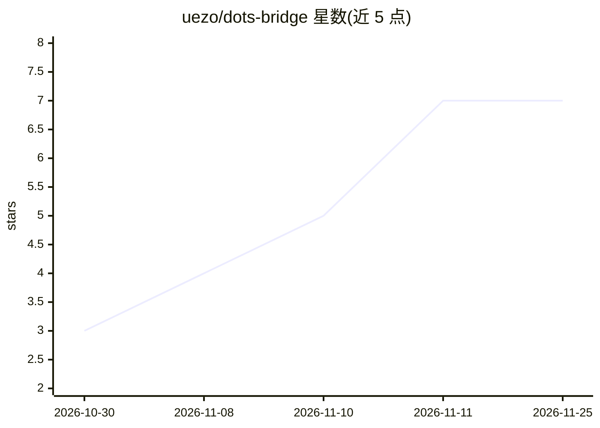

# uezo/dots-bridge

⭐ 7 · Python · MIT · 推送 2026-10-22 · [GitHub](https://github.com/uezo/dots-bridge) · 个人维护

**把 OpenAI dots 接入自己应用的 Python 桥接器，提供 OpenAI 兼容 API**

在自有应用与 ChatGPT 中的 OpenAI dots（常驻云端 agent）之间提供消息桥接：以 MCP 服务器身份注册为 dot 可连接的应用，应用侧通过 Python 客户端（send_message/ask/on_received 回调）或独立 connector 进程的 OpenAI 兼容 Chat Completions REST/SSE 与 Responses WebSocket 接口收发请求、进度更新、最终回复与主动推送。消息存于 SQLite，带 consumer_id 检查点恢复。需 Python 3.11+、dots 的 MCP Events 访问权限和公网 HTTPS URL（如 ngrok），仅支持文本对话，system 消息与生成参数不转发。

## 筛选速览

| 维度 | 判定 | 备注 |
|---|---|---|
| AI 角色 | `ai-ecosystem` | LLM/agent 周边工具 |
| 许可风险 | `permissive` | MIT |
| 部署形态 | `library` | 以包/库形式分发 |
| 模型依赖 | — | README 未给出锁定关系 |
| 硬件要求 | — | 无带数字的原话,不猜 |
| 安装摩擦 | `low` | 无编译、无系统依赖或容器化 |
| 成熟度 | — | 结构信号不足 |

## 能力要点

- 双向消息：请求、进度更新、最终回复与 dots 主动推送
- OpenAI 兼容接口（Chat Completions REST/SSE、Responses WebSocket），可用 dots 替代 GPT 作为自定义 base URL
- consumer_id 检查点与失败重试，支持从上次处理位置恢复
- SQLite 存储消息，提供 CLI（init/serve/subscriptions/connector）

## 适用场景

- 把 OpenAI dots 作为后端接入已有的 OpenAI 兼容应用
- 在 LINE、电话等自有服务中消费 dots 的回复与推送
- 通过回调把 dots 的处理结果接入自己的 agent 流程

## 场景标签

`模型网关` · 领域:Agent 开发

## 证据(README 行号)

> L3: A Python bridge between external applications and OpenAI dots, using HTTP and MCP Events.
> L157: The bridge exposes an HTTP API to applications and an MCP server to dots.
> L152: You can now use dots in place of GPT from any OpenAI-compatible app that supports text Chat Completions and a cust

## 星数曲线

2026-10-30 3 → 2026-11-25 7（+4）

---
*卡片 v1 · prompt 1.4 · 生成 2026-11-20 · 置信度 high · 依据 README sha `4f399e7773bc` · [字段定义](../../DATASET.md)*
