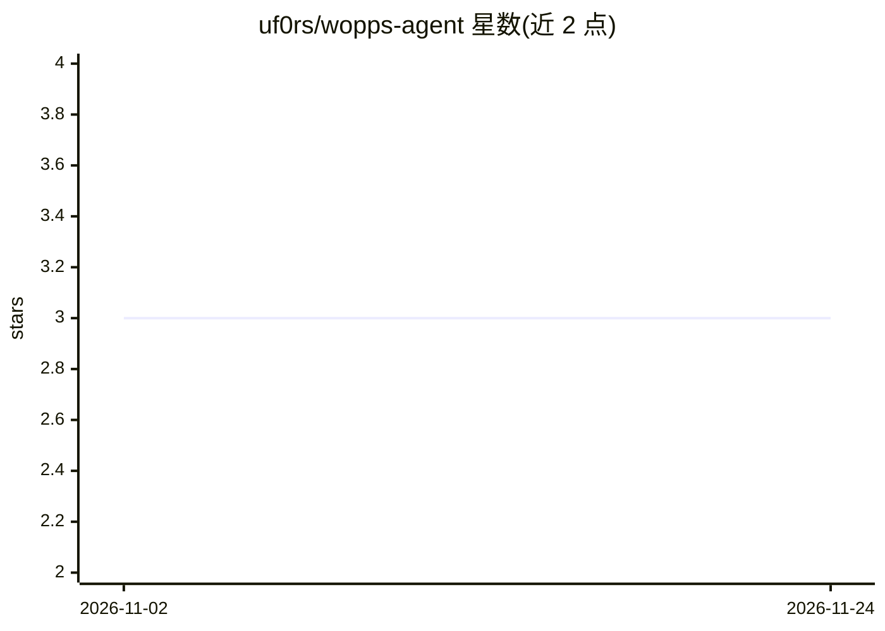

# uf0rs/wopps-agent

⭐ 3 · TypeScript · 推送 2026-11-02 · [GitHub](https://github.com/uf0rs/wopps-agent) · [官网](https://github.com/uf0rs/wopps-agent/releases/latest) · 组织维护

**面向终端用户的本地终端 AI 助手，含对话式视频剪辑功能**

UF0RS STUDIO 开发的本地 AI 助手，运行于终端与桌面，通过交互式 TUI 进行对话，展示模型操作、文件变更与命令输出。提供 /montage 命令，可将一句话生成包含配音、音乐与字幕的 MP4。支持打开指定项目、搜索并读取文件、提出并应用代码变更、执行命令与测试；电脑控制工具经本地 MCP 桥接提供，需确认的操作默认询问用户。Windows 提供单文件安装脚本，Linux/macOS 提供安装脚本，也可从源码构建。

## 筛选速览

| 维度 | 判定 | 备注 |
|---|---|---|
| AI 角色 | `ai-native` | 本体是模型或模型工具 |
| 许可风险 | `none` | — |
| 部署形态 | `desktop` | 安装包/桌面程序 |
| 模型依赖 | local-ok | 支持本地模型 |
| 硬件要求 | — | 无带数字的原话,不猜 |
| 安装摩擦 | `medium` | 含编译或系统依赖之一 |
| 成熟度 | — | 结构信号不足 |

## 能力要点

- 交互式 TUI 对话，展示模型动作、文件 diff 与命令输出
- /montage 从一句话生成 MP4（edge-tts 配音、numpy 合成音乐、Remotion 渲染）
- 通过本地 MCP 桥提供电脑控制工具，默认操作确认机制
- 支持 Ollama、OpenAI 兼容 API 与 OpenRouter 模型目录

## 适用场景

- 在终端用自然语言探索与修改本地项目代码
- 一句话生成带配音和字幕的短视频
- 通过 AI 助手执行本机命令与运行测试

## 场景标签

`AI 助手` `视频生成` · 领域:对话与助手

## 证据(README 行号)

> L7: **WOPPS** — локальный ИИ-помощник UF0RS STUDIO для терминала и рабочего стола. Открывает выбранный проект, ведёт диа
> L94: WOPPS может исследовать структуру проекта, искать и читать файлы, предлагать и применять изменения, показывать diff
> L96: Доступны провайдеры моделей, поддерживаемые ядром, включая Ollama и OpenAI-совместимые API. Для `llama.cpp` запусти

## 星数曲线

2026-11-02 3 → 2026-11-24 3（+0）

---
*卡片 v1 · prompt 1.4 · 生成 2026-11-22 · 置信度 mid · 依据 README sha `2415f127cfc2` · [字段定义](../../DATASET.md)*
