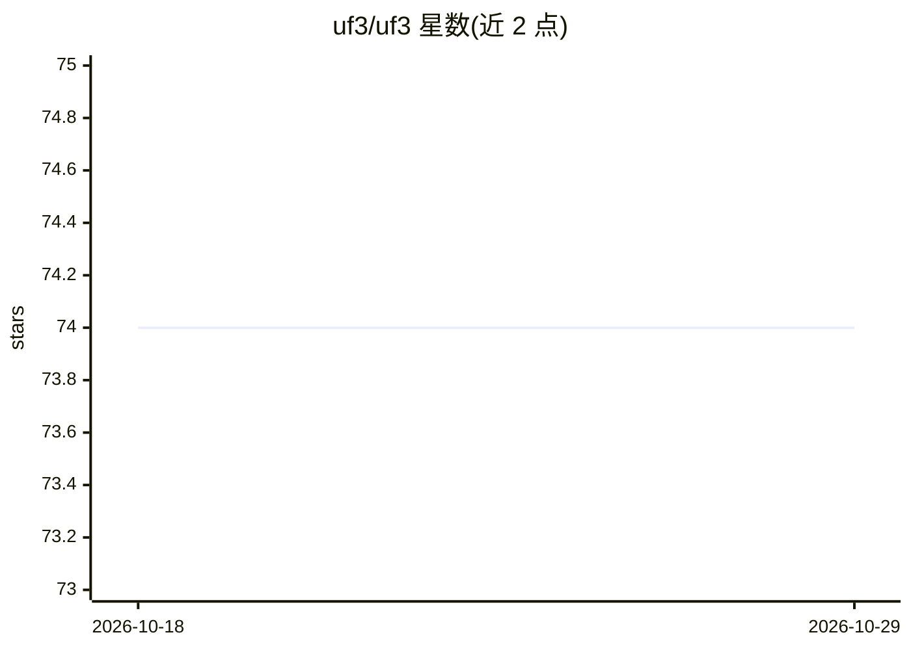

# uf3/uf3

⭐ 74 · Python · Apache-2.0 · 推送 2026-10-23 · [GitHub](https://github.com/uf3/uf3) · 组织维护

**生成超快机器学习原子间势的 Python 库**

面向物理、化学与材料科学的原子模拟研究者和开发者：以二体/三体势的立方 B-spline 基结合正则化线性回归，从第一性原理数据训练可解释且计算速度接近传统经验势的机器学习势。依赖 ase 解析 LAMMPS、VASP、CP2K 等原子模拟代码的输出，用 Pandas 管理构型与能量/力数据，scipy/numba/ndsplines 做 B-spline 求值，sklearn 做回归。通过 PyPI 或源码安装，提供弹性常数、声子谱等可选依赖与 LAMMPS 接口；README 自述仓库仍在建设中，部分模块概览与脚本为 WIP。

## 筛选速览

| 维度 | 判定 | 备注 |
|---|---|---|
| AI 角色 | `ai-native` | 本体是模型或模型工具 |
| 许可风险 | `permissive` | Apache-2.0 |
| 部署形态 | `library` | 以包/库形式分发 |
| 模型依赖 | — | README 未给出锁定关系 |
| 硬件要求 | — | 无带数字的原话,不猜 |
| 安装摩擦 | `low` | 无编译、无系统依赖或容器化 |
| 成熟度 | `idea` | |

## 能力要点

- 二体/三体势 + 立方 B-spline 基 + 正则化线性回归训练势函数
- 依赖 ase 解析 LAMMPS/VASP/CP2K 输出，含 LAMMPS 接口
- 可选安装弹性常数与声子谱扩展
- 提供 tungsten_extxyz 示例工程

## 适用场景

- 从第一性原理数据训练快速原子间势用于分子动力学模拟
- 为大规模或长时间尺度模拟生成接近经验势速度的 ML 势
- 计算材料的弹性常数与声子谱

## 场景标签

`模型训练` `科研工具` · 领域:学习与行业

## 证据(README 行号)

> L12: computational efficiency and predictive accuracy. The UF3 framework is
> L14: three-body potentials in a cubic B-spline basis with regularized linear
> L15: regression to obtain machine-learning potentials that are physically

## 星数曲线

2026-10-18 74 → 2026-10-29 74（+0）

---
*卡片 v1 · prompt 1.4 · 生成 2026-10-24 · 置信度 high · 依据 README sha `bbd732fc86e6` · [字段定义](../../DATASET.md)*
