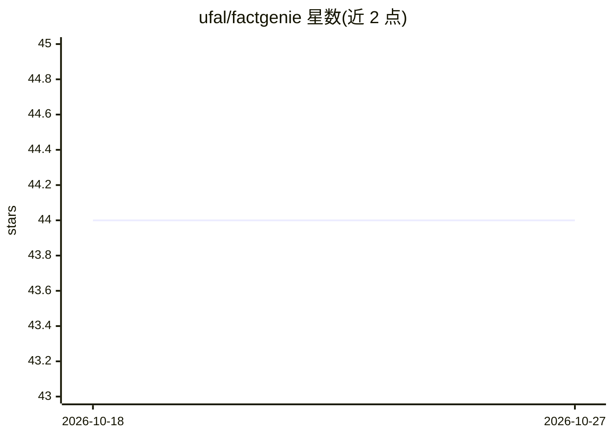

# ufal/factgenie

⭐ 44 · Python · MIT · 推送 2026-09-18 · [GitHub](https://github.com/ufal/factgenie) · [官网](https://quest.ms.mff.cuni.cz/nlg/d2t-llm/) · 组织维护

**自托管 LLM 输出的 span 标注与评估工具**

轻量级自托管 Web 应用，用于对 LLM 生成的文本做错误 span 标注：支持通过 API 调用 LLM 评估器自动标注，也支持通过众包服务收集人工标注，并提供数据与标注结果的可视化界面及统计分析。不负责数据收集、众包流程启动（需 Prolific 等服务）和 LLM 运行（需 Ollama 等本地框架或专有 API）。由布拉格查理大学 ufal 团队维护，论文发表于 INLG 2024 System Demonstrations。

## 筛选速览

| 维度 | 判定 | 备注 |
|---|---|---|
| AI 角色 | `ai-ecosystem` | LLM/agent 周边工具 |
| 许可风险 | `permissive` | MIT |
| 部署形态 | `library` | 以包/库形式分发 |
| 模型依赖 | local-ok | 支持本地模型 |
| 硬件要求 | — | 无带数字的原话,不猜 |
| 安装摩擦 | `low` | 无编译、无系统依赖或容器化 |
| 成熟度 | — | 结构信号不足 |

## 能力要点

- Web 界面收集众包人工标注
- API 调用 LLM 评估器做等效标注
- 数据与标注结果可视化及统计分析
- 提供数据集导入、输出生成、自定义可视化等教程

## 适用场景

- 对 LLM 输出做事实/语义错误的 span 标注与评估
- 通过众包平台收集人工标注数据
- 可视化检查模型生成结果与错误分布

## 场景标签

`模型评测` · 领域:评测与运维

## 证据(README 行号)

> L23: With factgenie, you can have the error spans annotated:
> L29: 2. **API calls** for collecting equivalent annotations from LLM-based evaluators.
> L32: *What does factgenie **not help with** is collecting the data (we assume that you already have these), starting the

## 星数曲线

2026-10-18 44 → 2026-10-27 44（+0）

---
*卡片 v1 · prompt 1.4 · 生成 2026-10-25 · 置信度 high · 依据 README sha `b9f24370fb6a` · [字段定义](../../DATASET.md)*
