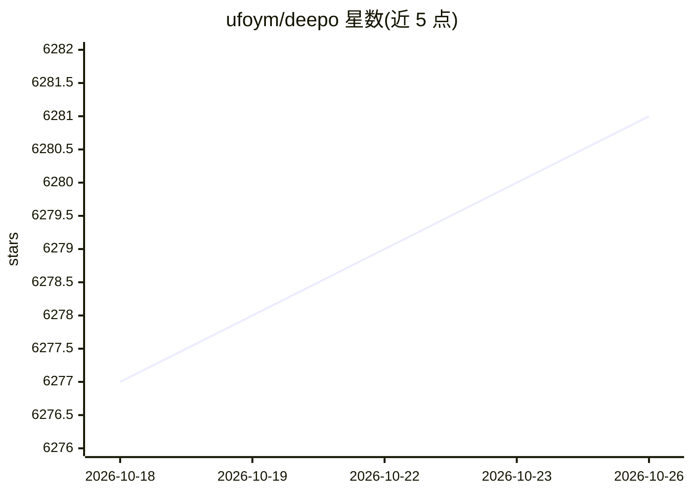

# ufoym/deepo

⭐ 6,281 · Python · MIT · 推送 2026-03-25 · [GitHub](https://github.com/ufoym/deepo) · [官网](http://ufoym.com/deepo) · 个人维护

**为深度学习研究组装定制 Docker 镜像的生成器与预构建镜像集**

Deepo 提供两部分：一个 Dockerfile 生成器，将数十个深度学习标准组件当作“乐高积木”，用单条命令描述环境，自动解析 CUDA/cuDNN/Python 与各框架（PyTorch、TensorFlow、Keras、MXNet 等）的版本兼容关系，经拓扑排序确定安装顺序并生成 Dockerfile；另提供 Docker Hub 上的预构建 all-in-one 镜像（含 CUDA 11.3/cuDNN 8/Python 3.8，亦支持 CPU-only），运行于 Linux/Windows/macOS，含 Jupyter 启动方式。旧版标签（Python 2.7/3.6、Theano、CNTK、Caffe 等）已标记为 Deprecated。

## 筛选速览

| 维度 | 判定 | 备注 |
|---|---|---|
| AI 角色 | `ai-ecosystem` | LLM/agent 周边工具 |
| 许可风险 | `permissive` | MIT |
| 部署形态 | `self-host` | docker 或自建部署 |
| 模型依赖 | — | README 未给出锁定关系 |
| 硬件要求 | `cpu-ok` | |
| 安装摩擦 | `low` | 无编译、无系统依赖或容器化 |
| 成熟度 | — | 结构信号不足 |

## 能力要点

- Dockerfile 生成器：单条命令描述环境，自动解析依赖并拓扑排序
- 预构建 all-in-one 与单框架 Docker 镜像（CUDA 11.3/cuDNN 8/Python 3.8）
- GPU（含 NVIDIA Container Toolkit 验证）与 CPU-only 两种模式
- 支持 Jupyter Lab 一条命令启动

## 适用场景

- 一条 docker pull 快速获得含主流深度学习框架的研究环境
- 按需生成只含指定框架与 CUDA 版本的定制镜像
- 在容器中隔离运行深度学习实验并挂载主机数据

## 场景标签

 · 领域:深度学习基础设施

## 证据(README 行号)

> L7: ***Deepo*** is an open framework for painlessly assembling specialized *Docker* images for deep learning research. I
> L9: At the core of Deepo is a Dockerfile generator that
> L19: We also provide a series of pre-built Docker images that

## 星数曲线

2026-10-18 6,277 → 2026-10-26 6,281（+4）

---
*卡片 v1 · prompt 1.4 · 生成 2026-10-20 · 置信度 high · 依据 README sha `0b0eb05ea962` · [字段定义](../../DATASET.md)*
