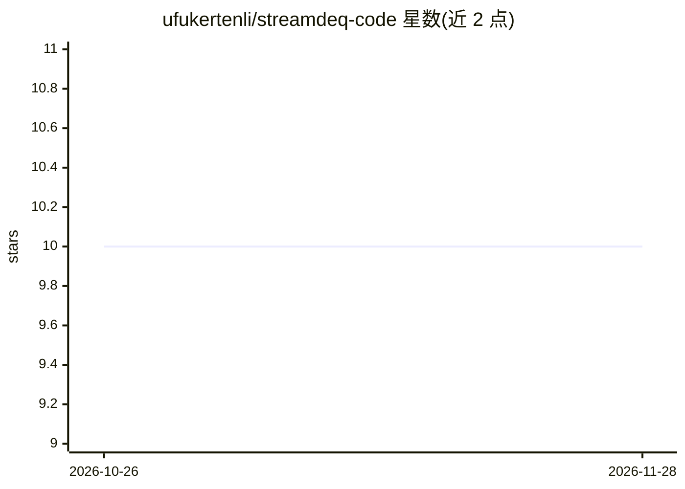

# ufukertenli/streamdeq-code

⭐ 10 · Python · 推送 2026-07-21 · [GitHub](https://github.com/ufukertenli/streamdeq-code) · [官网](https://ufukertenli.github.io/streamdeq/) · 组织维护

**视频流式推理的深度平衡模型官方实现（ECCV 2022）**

论文 StreamDEQ 的官方代码库：利用视频帧间变化缓慢的特性，将上一帧的表示作为当前帧不动点求解的初始条件，回收近期推理计算以减少逐帧处理时间。覆盖三个任务目录：Cityscapes 视频语义分割（MDEQ-Vision）、ImageNetVID 视频目标检测（MMDetection+MDEQ）、MPII 视频姿态估计（MMPose+MDEQ）。训练在静态图像上进行，流式推理为 inference-only 技术，提供 baseline/IL/UR/SUR 四种变体配置，复现脚本以 shell 形式给出，另附论文引用条目与项目页链接。

## 筛选速览

| 维度 | 判定 | 备注 |
|---|---|---|
| AI 角色 | `ai-native` | 本体是模型或模型工具 |
| 许可风险 | `none` | — |
| 部署形态 | `None` |  |
| 模型依赖 | — | README 未给出锁定关系 |
| 硬件要求 | — | 无带数字的原话,不猜 |
| 安装摩擦 | `low` | 无编译、无系统依赖或容器化 |
| 成熟度 | — | 结构信号不足 |

## 能力要点

- 不动点解复用（IL）与固定步数展开（UR/SUR）两种流式推理变体
- 支持视频分割、检测、姿态估计三个任务
- 回看帧数与迭代数通过配置文件名/字段控制
- 对应 ECCV 2022 论文及 Neurocomputing 扩展版官方实现

## 适用场景

- 复现流式 MDEQ 在 Cityscapes 分割上的实验
- 研究深度平衡模型的推理加速机制
- 在视频检测/姿态任务上对比流式与逐帧基线

## 场景标签

`目标检测` · 领域:感知与多模态

## 证据(README 行号)

> L3: This is the official implementation of Streaming Multiscale Deep Equilibrium Models (ECCV 2022) and its extended jou
> L7: StreamDEQ infers frame-wise representations on videos with minimal per-frame computation. In contrast to conventiona
> L13: |Video semantic segmentation|`Cityscapes/`|MDEQ-Vision|

## 星数曲线

2026-10-26 10 → 2026-11-28 10（+0）

---
*卡片 v1 · prompt 1.4 · 生成 2026-11-19 · 置信度 high · 依据 README sha `89d75398b14d` · [字段定义](../../DATASET.md)*
