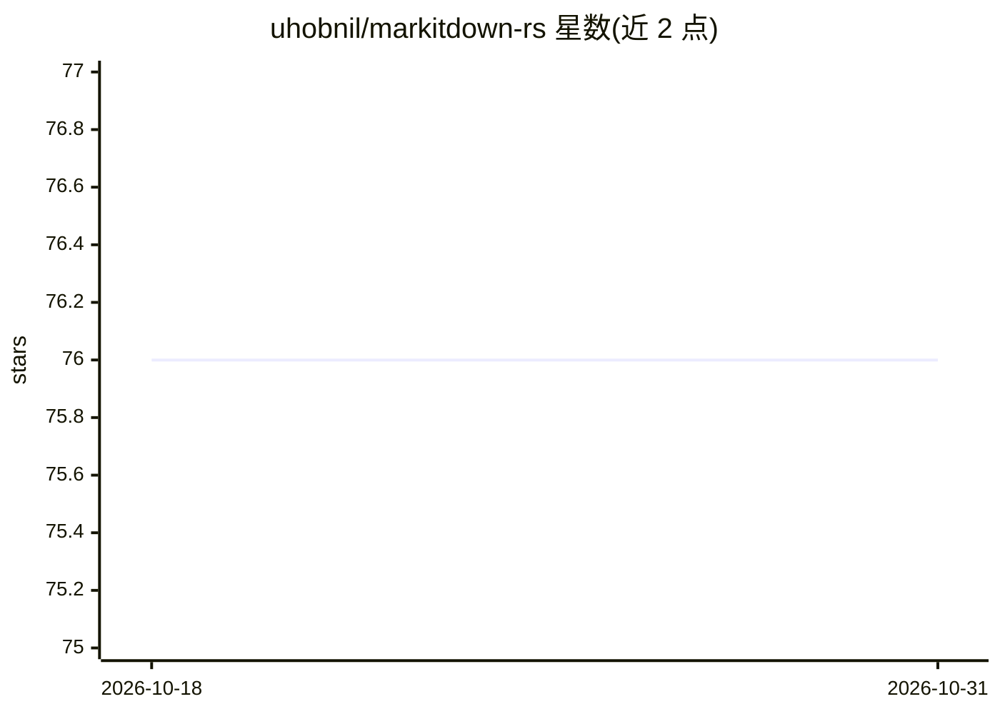

# uhobnil/markitdown-rs

⭐ 76 · Rust · MIT · 推送 2026-04-22 · [GitHub](https://github.com/uhobnil/markitdown-rs) · 个人维护

**Rust 文档转 Markdown 库：多格式文件转 Markdown 供后续处理**

markitdown Python 库的 Rust 实现，将 xlsx、docx、PowerPoint、PDF、图片、HTML、CSV、XML/RSS/Atom、ZIP 等格式转换为 Markdown 文本（音频尚未支持）。以 cargo crate 形式提供 Rust API，文件类型自动检测，也可从字节数据转换，并可通过实现 DocumentConverter trait 注册自定义转换器；同时提供命令行工具（cargo install markitdown）按文件转换并指定输出。MIT 许可。

## 筛选速览

| 维度 | 判定 | 备注 |
|---|---|---|
| AI 角色 | `ai-ecosystem` | LLM/agent 周边工具 |
| 许可风险 | `permissive` | MIT |
| 部署形态 | `library` | 以包/库形式分发 |
| 模型依赖 | — | README 未给出锁定关系 |
| 硬件要求 | — | 无带数字的原话,不猜 |
| 安装摩擦 | `low` | 无编译、无系统依赖或容器化 |
| 成熟度 | — | 结构信号不足 |

## 能力要点

- 支持 xlsx/docx/PPT/PDF/图片/HTML/CSV/XML/ZIP 等格式转 Markdown
- 文件类型自动检测，支持从字节数据转换
- 可通过 DocumentConverter trait 注册自定义转换器
- 提供 Rust API 与命令行两种使用方式

## 适用场景

- 在 Rust 项目中把办公文档转成 Markdown 供文本流程使用
- 为 LLM/RAG 流水线准备统一格式的文档输入
- 命令行批量转换单个文档为 Markdown

## 场景标签

`文档解析` · 领域:知识与检索

## 证据(README 行号)

> L3: markitdown-rs is a Rust library designed to facilitate the conversion of various document formats into markdown text
> L9: - [x] Excel(.xlsx)

## 星数曲线

2026-10-18 76 → 2026-10-31 76（+0）

---
*卡片 v1 · prompt 1.4 · 生成 2026-10-24 · 置信度 mid · 依据 README sha `ddd545624d7a` · [字段定义](../../DATASET.md)*
