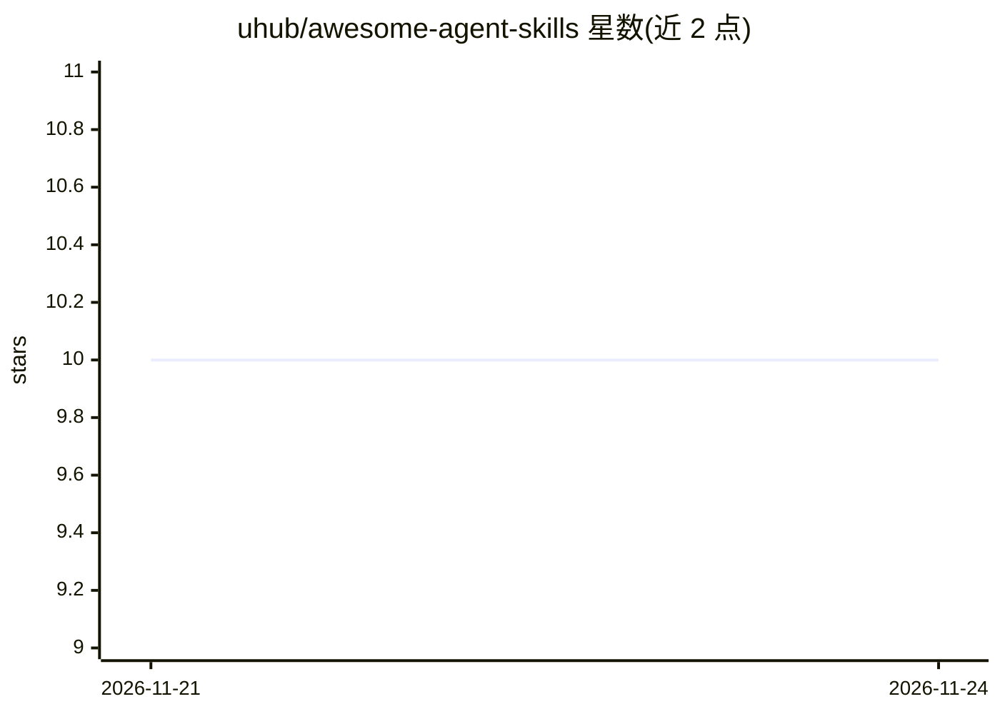

# uhub/awesome-agent-skills

⭐ 10 · 推送 2026-11-11 · [GitHub](https://github.com/uhub/awesome-agent-skills) · 个人维护 · 中文 README

**Agent Skills 生态的精选资源清单，供开发者检索框架与技能**

按主题分类组织的 Agent Skills 精选清单（awesome list），目录覆盖学习参考、语言与工具链、Web、数据与存储、机器学习与 AI、AI Agents 等十余类，条目为指向第三方仓库的链接加一句话说明。收录对象包括各语言的 agent skills 集合、Claude Code/OpenCode 等工具的教程与中文翻译项目、以及多个同主题的 awesome 列表与论文清单。清单本身不含可安装产物，价值在于检索与导航第三方技能资源。

## 筛选速览

| 维度 | 判定 | 备注 |
|---|---|---|
| AI 角色 | `ai-knowledge` | 知识聚合/清单类 |
| 许可风险 | `none` | — |
| 部署形态 | `library` | 以包/库形式分发 |
| 模型依赖 | — | README 未给出锁定关系 |
| 硬件要求 | — | 无带数字的原话,不猜 |
| 安装摩擦 | `medium` | 含编译或系统依赖之一 |
| 成熟度 | — | 结构信号不足 |

## 能力要点

- 按十余个主题类别组织的 Agent Skills 资源目录
- 收录教程、技能集合、同主题 awesome 列表与论文清单
- 含多个面向中文用户的技能教程与排行榜项目条目

## 适用场景

- 为 Claude Code、Cursor 等 agent 工具查找现成技能
- 了解 Agent Skills 生态有哪些框架与资源
- 查找某个语言或框架（Vue/Spring/WordPress 等）的技能集合

## 场景标签

`精选清单` · 领域:学习与行业

## 证据(README 行号)

> L3: A curated list of awesome Agent Skills frameworks, libraries and software.
> L21: * AI Agents

## 星数曲线

2026-11-21 10 → 2026-11-24 10（+0）

---
*卡片 v1 · prompt 1.4 · 生成 2026-11-21 · 置信度 mid · 依据 README sha `fb513eba3a66` · [字段定义](../../DATASET.md)*
