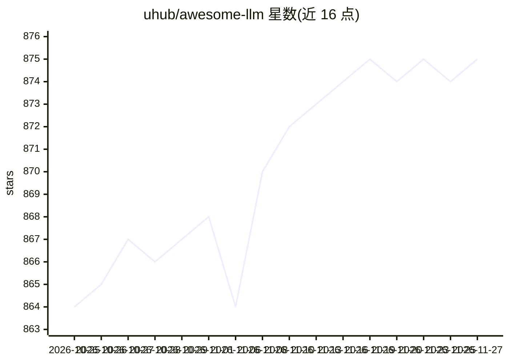

# uhub/awesome-llm

⭐ 875 · 推送 2026-11-25 · [GitHub](https://github.com/uhub/awesome-llm) · 组织维护 · 中文 README

**面向开发者的 LLM 框架、库与软件策展清单**

以 awesome list 形式组织的 LLM 生态资源目录，按学习与参考、语言与工具、Web、数据与存储、机器学习与 AI、AI Agents、用户界面、安全、性能、商业领域等类别分级编排条目，每条附仓库与一句话说明。可见部分主要收录教程、书籍与实战课程（含大量中文资料如 datawhalechina 系列、LLMs-from-scratch 中文翻译等）。README 本身不含安装或运行说明，仅提供链接式条目列表。

## 筛选速览

| 维度 | 判定 | 备注 |
|---|---|---|
| AI 角色 | `ai-knowledge` | 知识聚合/清单类 |
| 许可风险 | `none` | — |
| 部署形态 | `None` |  |
| 模型依赖 | — | README 未给出锁定关系 |
| 硬件要求 | — | 无带数字的原话,不猜 |
| 安装摩擦 | `medium` | 含编译或系统依赖之一 |
| 成熟度 | — | 结构信号不足 |

## 能力要点

- 按十余个类别分级组织的 LLM 资源目录结构
- 收录教程、书籍、示例代码与练习等多种资源类型
- 包含大量中文教程条目（datawhalechina 系列、中文翻译与中文原创指南）

## 适用场景

- 查找 LLM 入门教程与系统学习路线
- 按类别浏览 LLM 相关框架、库和软件资源
- 寻找中文大模型学习资料与面试题库

## 场景标签

`精选清单` · 领域:学习与行业

## 证据(README 行号)

> L3: A curated list of awesome LLM frameworks, libraries and software.
> L5: * Learning and Reference
> L39: ### Tutorials and Books

## 星数曲线

2026-10-25 864 → 2026-11-27 875（+11）

---
*卡片 v1 · prompt 1.4 · 生成 2026-11-26 · 置信度 high · 依据 README sha `36c23f2c1b9c` · [字段定义](../../DATASET.md)*
