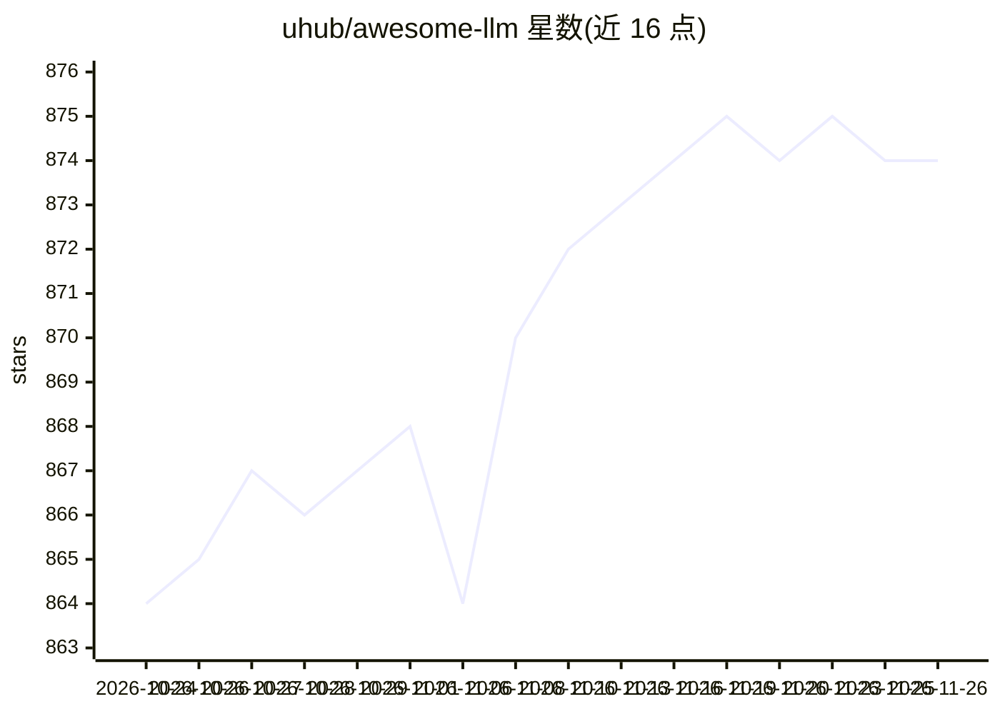

# uhub/awesome-llm

⭐ 874 · 推送 2026-11-25 · [GitHub](https://github.com/uhub/awesome-llm) · 个人维护

**LLM 框架、库与软件的策展清单，供开发者检索资源**

一个以 awesome 清单形式组织的 LLM 生态资源目录，按学习参考、语言与工具链、Web、数据存储、机器学习与 AI、AI Agents、用户界面、图形媒体、安全、性能、实用工具、商业领域等分类收录仓库条目。可见部分为「Tutorials and Books」分类，收录约 80 个教程、书籍与课程仓库，含中英文资源；后续章节（示例练习、工具、应用等）延伸至更长的目录。README 本身不含安装或运行说明，仅提供条目链接式罗列。

## 筛选速览

| 维度 | 判定 | 备注 |
|---|---|---|
| AI 角色 | `ai-knowledge` | 知识聚合/清单类 |
| 许可风险 | `none` | — |
| 部署形态 | `None` |  |
| 模型依赖 | — | README 未给出锁定关系 |
| 硬件要求 | — | 无带数字的原话,不猜 |
| 安装摩擦 | `medium` | 含编译或系统依赖之一 |
| 成熟度 | — | 结构信号不足 |

## 能力要点

- 按十余个主题分类组织 LLM 相关框架、库与软件条目
- 收录中英文教程、书籍、课程与面试资源（如 Datawhale 系列、LLM101n）
- 覆盖从入门学习到工程化、RAG、Agent 等主题的资源

## 适用场景

- 查找 LLM 学习路线和入门教程资源
- 按类别浏览大模型生态中的框架与工具
- 检索 RAG、Agent 等方向的实践项目参考

## 场景标签

`精选清单` `教程课程` · 领域:学习与行业

## 证据(README 行号)

> L3: A curated list of awesome LLM frameworks, libraries and software.
> L5: * Learning and Reference
> L39: ### Tutorials and Books

## 星数曲线

2026-10-24 864 → 2026-11-26 874（+10）

---
*卡片 v1 · prompt 1.4 · 生成 2026-11-24 · 置信度 high · 依据 README sha `a7ce7e9be5c5` · [字段定义](../../DATASET.md)*
