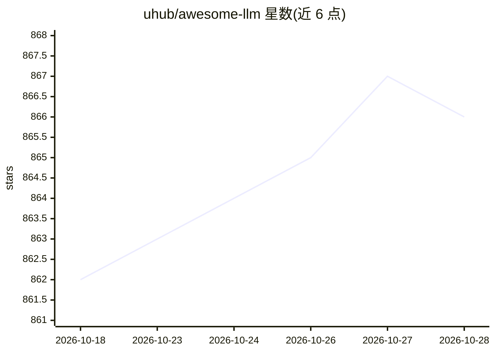

# uhub/awesome-llm

⭐ 866 · 推送 2026-10-22 · [GitHub](https://github.com/uhub/awesome-llm) · 个人维护 · 中文 README

**LLM 框架、库与软件的策展清单，供开发者查找学习资源与工具**

由 uhub 维护的 awesome list，聚合 LLM 相关的框架、库与软件条目，按学习参考、语言与工具、Web、数据存储、机器学习与 AI、安全、命令行工具、商业领域等大类组织。可见部分以 Tutorials and Books 小节为主，收录从零实现 LLM、RAG 技术、Agent 开发、提示工程等教程与书籍项目，条目多为中文或英文开源教程仓库。清单本身为纯链接目录，不提供可安装运行的软件，使用方式为浏览目录并跳转至对应仓库。

## 筛选速览

| 维度 | 判定 | 备注 |
|---|---|---|
| AI 角色 | `ai-knowledge` | 知识聚合/清单类 |
| 许可风险 | `none` | — |
| 部署形态 | `None` |  |
| 模型依赖 | — | README 未给出锁定关系 |
| 硬件要求 | — | 无带数字的原话,不猜 |
| 安装摩擦 | `medium` | 含编译或系统依赖之一 |
| 成熟度 | — | 结构信号不足 |

## 能力要点

- 按十余个大类组织的 LLM 资源目录
- Tutorials and Books 小节收录大量从零构建 LLM、RAG、Agent 的教程仓库
- 条目覆盖中英文教程、书籍与实战项目

## 适用场景

- 查找从零实现大模型的学习教程
- 了解 RAG、Agent、提示工程方向的资源分布
- 按类别浏览 LLM 生态的库与工具

## 场景标签

`精选清单` · 领域:学习与行业

## 证据(README 行号)

> L3: A curated list of awesome LLM frameworks, libraries and software.
> L41: * rasbt/LLMs-from-scratch - Implement a ChatGPT-like LLM in PyTorch from scratch, step by step

## 星数曲线

2026-10-18 862 → 2026-10-28 866（+4）

---
*卡片 v1 · prompt 1.4 · 生成 2026-10-21 · 置信度 high · 依据 README sha `d1b11345a541` · [字段定义](../../DATASET.md)*
