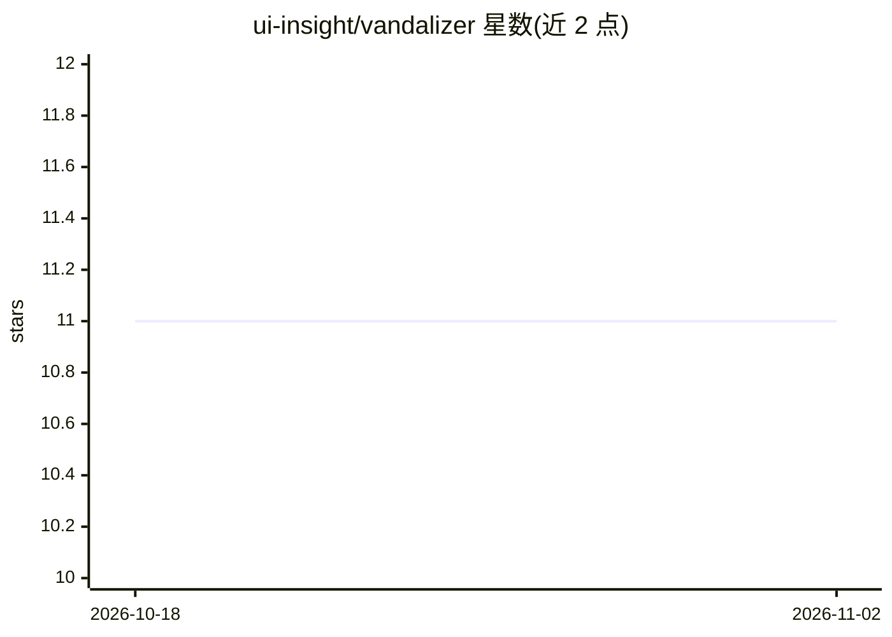

# ui-insight/vandalizer

⭐ 11 · Python · GPL-3.0 · 推送 2026-11-01 · [GitHub](https://github.com/ui-insight/vandalizer) · 组织维护

**高校科研管理文档的 AI 审查与结构化数据提取平台**

面向大学科研管理办公室（ Sponsored Programs、资助与合规团队）的自托管平台，用可配置的 LLM 工作流从经费申请、获奖文件、监管申报等 PDF 中提取截止日期、预算、合规要求、PI 信息等结构化数据，逐字段可溯源到原文页码；支持将提取任务链成带依赖解析的流水线，并提供基于文档库的 RAG 问答、多租户团队协作、白标部署与自动化触发。运行时在管理界面配置任意 OpenAI 兼容 LLM 提供商（含本地 Ollama），OCR 走 Docling-Serve/自托管服务或 PyPDF2 回退，也支持多模态视觉提取。Docker Compose 一键部署，附 Helm Chart，单服务器 16GB 内存即可运行。

## 筛选速览

| 维度 | 判定 | 备注 |
|---|---|---|
| AI 角色 | `ai-native` | 本体是模型或模型工具 |
| 许可风险 | `viral` | GPL-3.0 |
| 部署形态 | `self-host` | docker 或自建部署 |
| 模型依赖 | local-ok | 支持本地模型 |
| 硬件要求 | — | 无带数字的原话,不猜 |
| 安装摩擦 | `low` | 无编译、无系统依赖或容器化 |
| 成熟度 | — | 结构信号不足 |

## 能力要点

- LLM 驱动的结构化提取，逐字段来源追踪（点击跳转原文页码）
- 任务链式工作流引擎与 RAG 引用式问答
- 运行时配置任意 OpenAI 兼容提供商，含 Ollama 本地模型，支持全离线部署
- Docker Compose 部署脚本与 Kubernetes Helm Chart

## 适用场景

- 科研管理办公室批量提取经费文件的截止日期、预算与合规要求
- 对文档库做带引用的自然语言问答
- 将提取任务编排为可重复的流水线并自动化触发

## 场景标签

`工作流自动化` `RAG` `文档解析` · 领域:效率与自动化

## 证据(README 行号)

> L8: **AI-powered document intelligence for research administration.**
> L12: These offices typically review hundreds of documents per cycle to extract deadlines, budgets, compliance requiremen
> L14: The project was developed at the University of Idaho under the NSF GRANTED program (Award #2427549) and is designed

## 星数曲线

2026-10-18 11 → 2026-11-02 11（+0）

---
*卡片 v1 · prompt 1.4 · 生成 2026-11-01 · 置信度 high · 依据 README sha `4295544a20c6` · [字段定义](../../DATASET.md)*
