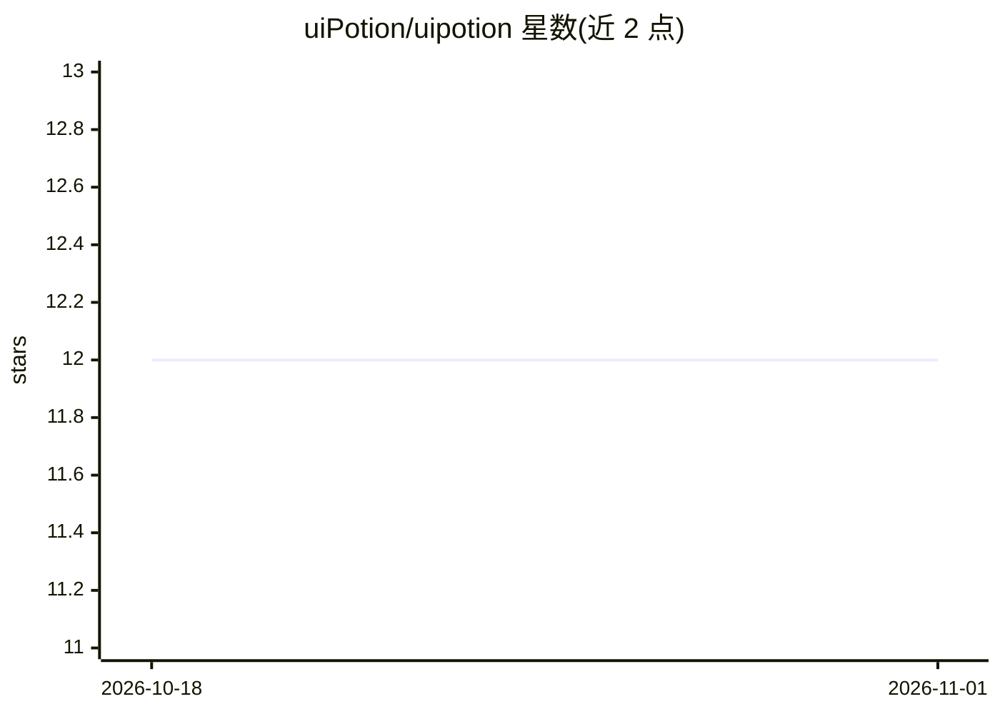

# uiPotion/uipotion

⭐ 12 · JavaScript · NOASSERTION · 推送 2026-10-29 · [GitHub](https://github.com/uiPotion/uipotion) · [官网](https://uipotion.com) · 组织维护

**给 AI 编码助手的框架无关 UI 行为规范目录**

面向 AI 编码助手（如 Cursor、Copilot）的 UI 行为指南目录：每条 "potion" 以 JSON 与 Markdown 描述 UI 的结构、行为、可访问性、响应式规则与验收清单，由编码代理读取后适配用户现有框架与样式系统生成实现代码。它不是组件库，无运行时依赖，无需在应用中安装任何东西；使用方式是把指南 URL 或本地副本路径粘贴给编码代理。另有清单文件与 schema 供构建发现/搜索，开发本站需 Node.js 24+。

## 筛选速览

| 维度 | 判定 | 备注 |
|---|---|---|
| AI 角色 | `ai-knowledge` | 知识聚合/清单类 |
| 许可风险 | `permissive` | NOASSERTION |
| 部署形态 | `None` |  |
| 模型依赖 | — | README 未给出锁定关系 |
| 硬件要求 | — | 无带数字的原话,不猜 |
| 安装摩擦 | `low` | 无编译、无系统依赖或容器化 |
| 成熟度 | — | 结构信号不足 |

## 能力要点

- 每条 potion 提供结构/行为/可访问性/响应式规范与验收清单（testingChecklist）
- 框架无关、样式无关，代理复用项目现有框架与设计令牌
- 无需安装运行时依赖，通过分享指南 URL 给编码代理使用
- 提供 manifest、potions 索引、schema 与 llms.txt 供编程式访问

## 适用场景

- 让我的编码代理按规范实现仪表盘、模态框等 UI
- 用检查提示词比对现有 UI 实现与规范的差距
- 为自建 agent 构建按规范检索/发现功能

## 场景标签

`提示工程` · 领域:Agent 开发

## 证据(README 行号)

> L10: UI Potion is a catalog of framework-agnostic, styling-agnostic UI specifications for AI coding assistants. It is no
> L12: Think of it as "recipes for AI" - detailed guides that your AI assistant reads and adapts to your existing technolo

## 星数曲线

2026-10-18 12 → 2026-11-01 12（+0）

---
*卡片 v1 · prompt 1.4 · 生成 2026-10-31 · 置信度 high · 依据 README sha `076229719e34` · [字段定义](../../DATASET.md)*
