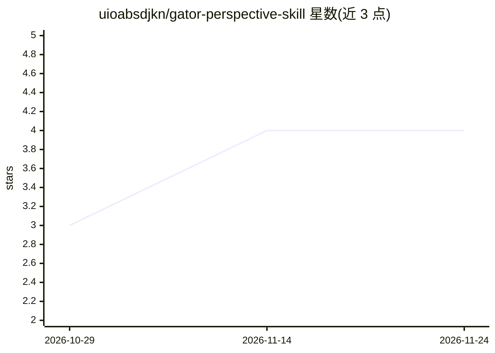

# uioabsdjkn/gator-perspective-skill

⭐ 4 · Python · NOASSERTION · 推送 2026-10-21 · [GitHub](https://github.com/uioabsdjkn/gator-perspective-skill) · 个人维护 · 中文 README

**给 AI 加载 A 股鳄鱼派交易思维框架的视角 Skill**

从 1643 篇/474 万字公众号复盘语料蒸馏的人物视角 Skill，包含 7 个心智模型、10 条决策启发式、量化表达 DNA 与本体库，供兼容 Skill 的运行时（WorkBuddy、Claude Code 等）加载，以特定投资视角生成条件式行情分析。README 主动写明诚实边界：流程改版多次且曾有矛盾叙事、非精确预测工具、语料有时效性，并声明仅供研究、不构成投资建议，语料版权归原作者。

## 筛选速览

| 维度 | 判定 | 备注 |
|---|---|---|
| AI 角色 | `ai-knowledge` | 知识聚合/清单类 |
| 许可风险 | `none` | NOASSERTION |
| 部署形态 | `None` |  |
| 模型依赖 | — | README 未给出锁定关系 |
| 硬件要求 | — | 无带数字的原话,不猜 |
| 安装摩擦 | `low` | 无编译、无系统依赖或容器化 |
| 成熟度 | — | 结构信号不足 |

## 能力要点

- 7 个心智模型，每个经跨域复现/生成力/排他性三重验证
- 10 条决策启发式与量化表达 DNA（反问密度、比喻密度等）
- 激活后按五维度先查真实行情再输出条件式结论
- README 列明局限与自相矛盾处，不做调和

## 适用场景

- 让 AI 以鳄鱼派视角解读当日 A 股行情
- 分析某次回调时获取条件式而非单边判断
- 研究该交易思维框架的心智模型与决策规则

## 场景标签

`提示工程` `金融量化` · 领域:Agent 开发

## 证据(README 行号)

> L3: > 从「像鳄鱼一样思考」日更复盘 **1643 篇 / 474 万字**语料中蒸馏出的 A 股交易思维框架 Skill。
> L33: Claude Code / 其他兼容 Skill 的运行时：
> L43: 用鳄鱼派的视角看看今天的行情

## 星数曲线

2026-10-29 3 → 2026-11-24 4（+1）

---
*卡片 v1 · prompt 1.4 · 生成 2026-11-21 · 置信度 high · 依据 README sha `7b675b181584` · [字段定义](../../DATASET.md)*
