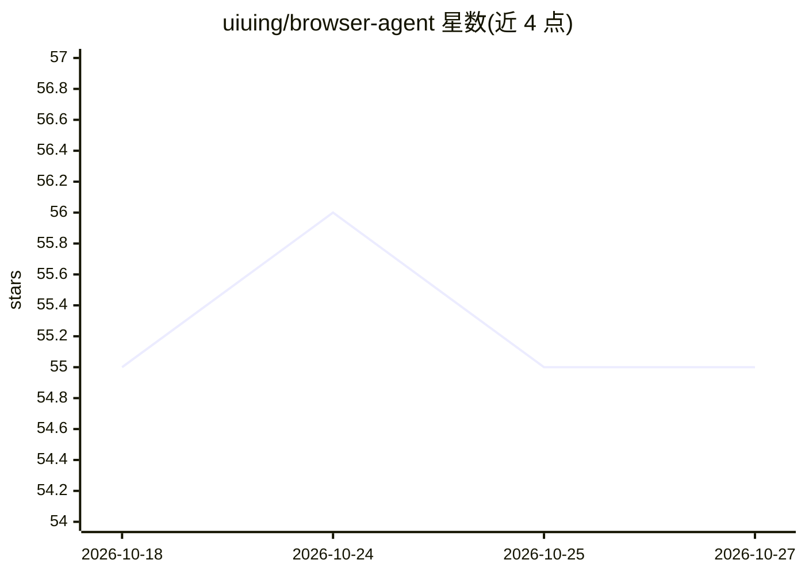

# uiuing/browser-agent

⭐ 55 · TypeScript · MIT · 推送 2026-07-09 · [GitHub](https://github.com/uiuing/browser-agent) · 个人维护 · 中文 README

**开源浏览器 AI Agent 运行时：自带模型执行并核验网页操作**

Chrome MV3 扩展形式的浏览器 Agent 运行时：模型在侧边栏的 agent 循环中解读任务并调用工具，运行时负责上下文组装、类型化工具注册（Zod schema、风险分级）、页面执行（page_act 六层管线：感知/定位/执行/校验/失败处理/追踪）、DOM 后置条件校验、护栏（风险分级、站点策略、确认提示、审计日志）与技能复用（验证通过的工作流可提取为技能并批量执行）。模型提供方支持 OpenAI Chat Completions/Responses、Anthropic Messages，无原生工具调用时回退为提示式 JSON 协议。需从源码构建后以 Load unpacked 方式加载，无后端、无遥测。

## 筛选速览

| 维度 | 判定 | 备注 |
|---|---|---|
| AI 角色 | `ai-ecosystem` | LLM/agent 周边工具 |
| 许可风险 | `permissive` | MIT |
| 部署形态 | `library` | 以包/库形式分发 |
| 模型依赖 | — | README 未给出锁定关系 |
| 硬件要求 | — | 无带数字的原话,不猜 |
| 安装摩擦 | `low` | 无编译、无系统依赖或容器化 |
| 成熟度 | — | 结构信号不足 |

## 能力要点

- page_act 统一执行入口，六层管线含 DOM 后置条件校验（value_equals/list_count_delta 等）
- 工具以 ToolDefinition 注册，Zod schema 定义参数并声明 read/act/dangerous 风险分级
- 验证通过的工作流可提取为技能，支持逐行验证的批量执行
- 支持挂载 Streamable HTTP MCP 服务器，远程工具经本地护栏

## 适用场景

- 让自带模型在真实网页上完成填表、点击、上传等操作并核验结果
- 将验证通过的流程提取为技能，批量重复执行数据任务
- 通过护栏与审计日志控制提交、支付、删除等高风险操作

## 场景标签

`浏览器自动化` `Agent 框架` · 领域:Agent 开发

## 证据(README 行号)

> L17: Browser Agent is a Chrome MV3 extension and a runtime for browser agents. It places a model inside a structured bro
> L28: The product surface today is a browser side panel. The core of the project is the runtime behind it: the agent loop
> L118: Model providers are implemented under `llm/`. Current providers include:

## 星数曲线

2026-10-18 55 → 2026-10-27 55（+0）

---
*卡片 v1 · prompt 1.4 · 生成 2026-10-24 · 置信度 mid · 依据 README sha `d8b9c9562ecb` · [字段定义](../../DATASET.md)*
