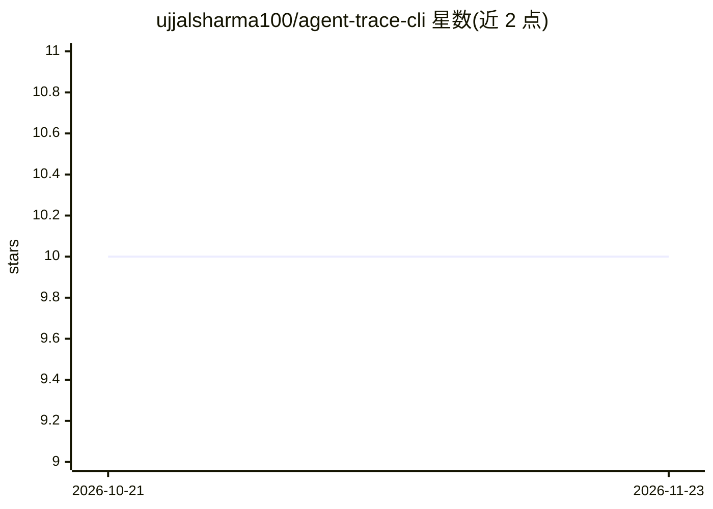

# ujjalsharma100/agent-trace-cli

⭐ 10 · Python · Apache-2.0 · 推送 2026-07-25 · [GitHub](https://github.com/ujjalsharma100/agent-trace-cli) · [官网](http://cli.traceshub.com/) · 个人维护

**为编码工具追溯 AI 生成代码行的 CLI 归因工具**

通过 Cursor、Claude Code、Codex CLI 的 hook 记录会话 trace，在 commit 时用逐行 SHA-256 哈希比对生成确定性归因账本，blame 输出每行二值归属（AI 或无归属），并可还原该行背后的对话上下文。本地优先存储于 ~/.agent-trace/，通过 git notes 与 push/pull/sync 分享元数据，可选 HTTP 远端仅作数据存储。零外部依赖，仅需 Python 3.9+；可选的会话摘要预设需 PATH 中有 ollama。

## 筛选速览

| 维度 | 判定 | 备注 |
|---|---|---|
| AI 角色 | `ai-enhanced` | 去掉 AI 部分产品仍成立 |
| 许可风险 | `permissive` | Apache-2.0 |
| 部署形态 | `library` | 以包/库形式分发 |
| 模型依赖 | local-ok | 支持本地模型 |
| 硬件要求 | — | 无带数字的原话,不猜 |
| 安装摩擦 | `low` | 无编译、无系统依赖或容器化 |
| 成熟度 | — | 结构信号不足 |

## 能力要点

- 确定性归因账本：commit 时逐行哈希比对，binary 归属，无启发式猜测路径
- git-like push/pull/sync 与 git notes（refs/notes/agent-trace）共享归因元数据
- browser 文件查看器：git blame 与 agent-trace blame 并列显示
- 支持 post-rewrite 钩子在 rebase/amend 后重映射账本 SHA

## 适用场景

- 区分提交中哪些行是 AI 生成的，哪些是自己写的
- 为某段 AI 代码找回当时 prompting 会话的完整对话
- 团队仓库中共享 AI 归因元数据

## 场景标签

 · 领域:开发者工具/代码溯源

## 证据(README 行号)

> L3:  Trace AI-generated code changes across Cursor, Claude Code, and Codex CLI.
> L109: Zero-prompt initialization — like `git init`. Writes `project-config.json` for the repo, enables notes (including 

## 星数曲线

2026-10-21 10 → 2026-11-23 10（+0）

---
*卡片 v1 · prompt 1.4 · 生成 2026-11-19 · 置信度 high · 依据 README sha `060bcc664088` · [字段定义](../../DATASET.md)*
