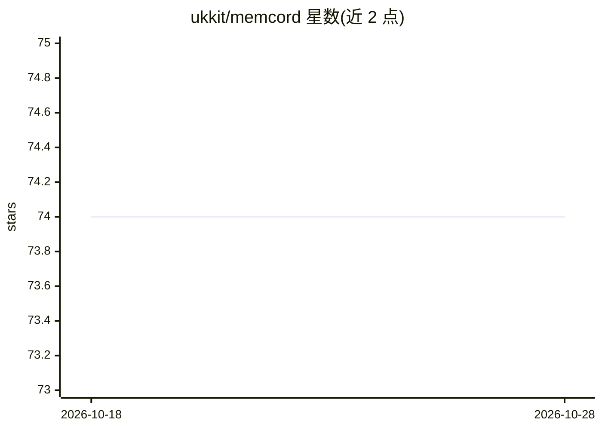

# ukkit/memcord

⭐ 74 · Python · MIT · 推送 2026-08-07 · [GitHub](https://github.com/ukkit/memcord) · [官网](https://github.com/ukkit/memcord/releases) · 个人维护

**自托管隐私优先的 MCP 服务器：本地保存与检索 AI 对话长期记忆**

面向 Claude Code、Claude Desktop、VSCode 和 Google Antigravity 等客户端的自托管 MCP 记忆服务器：按项目创建记忆槽位，保存、读取、全文检索与自然语言查询历史对话，自动摘要与智能合并去重，100% 本地存储、无云端和数据库依赖。提供 23 个工具与 17 个 slash 命令，支持自定义存储路径（如 Dropbox 目录跨设备共享）和四种可插拔摘要后端（nltk/sumy/semantic/transformers），按槽位切换无需重启。通过 install.sh/install.ps1 一键安装并自动生成各 IDE 的 MCP 配置，需 Python 3.10+ 和 uv。

## 筛选速览

| 维度 | 判定 | 备注 |
|---|---|---|
| AI 角色 | `ai-ecosystem` | LLM/agent 周边工具 |
| 许可风险 | `permissive` | MIT |
| 部署形态 | `library` | 以包/库形式分发 |
| 模型依赖 | locked-api |  |
| 硬件要求 | — | 无带数字的原话,不猜 |
| 安装摩擦 | `low` | 无编译、无系统依赖或容器化 |
| 成熟度 | — | 结构信号不足 |

## 能力要点

- 按项目的记忆槽位与 .memcord 绑定自动路由读写
- 23 个工具含全文搜索与自然语言查询（memcord_search / memcord_query）
- 四种可插拔摘要后端，按槽位切换无需重启
- 支持自定义存储路径（Dropbox/OneDrive）跨设备共享记忆

## 适用场景

- 让 Claude 在多轮会话与多个项目间保留上下文记忆
- 在本地检索过去对话中做过的决定
- 跨设备共享同一份项目记忆数据

## 场景标签

`Agent 记忆` · 领域:Agent 开发

## 证据(README 行号)

> L1: MEMCORD v4.3.6 (mcp server)
> L2:  This privacy-first, self-hosted MCP server helps you organize chat history, summarize messages, search across past 
> L59: - ✅ Configure Claude Desktop, Claude Code, VSCode, and Antigravity IDE

## 星数曲线

2026-10-18 74 → 2026-10-28 74（+0）

---
*卡片 v1 · prompt 1.4 · 生成 2026-10-24 · 置信度 mid · 依据 README sha `e7bdd7688859` · [字段定义](../../DATASET.md)*
