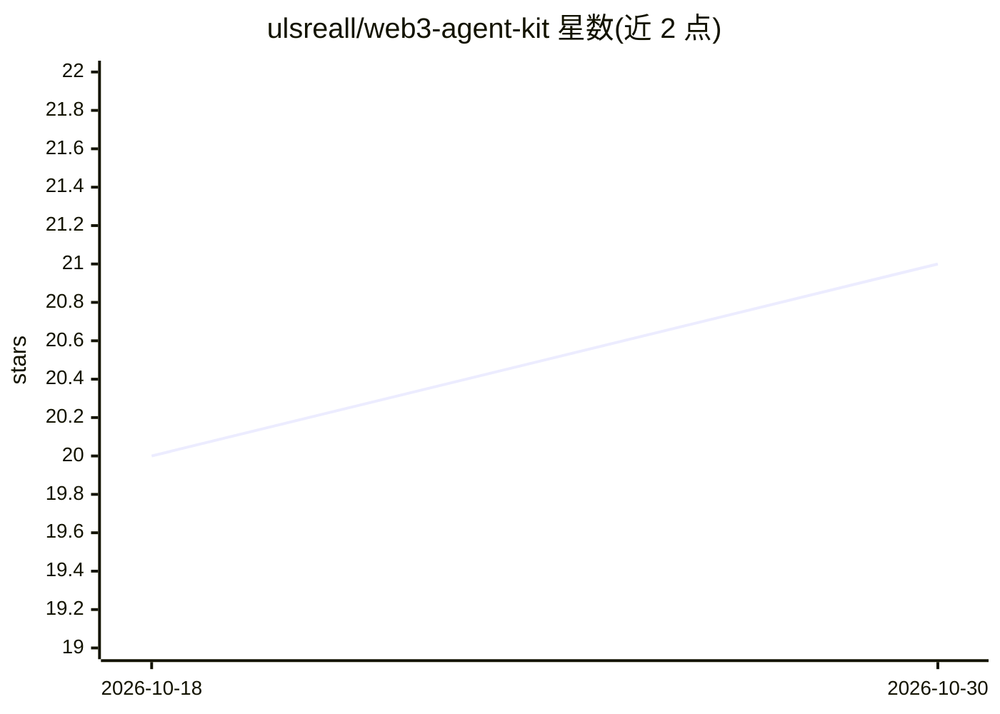

# ulsreall/web3-agent-kit

⭐ 21 · Python · MIT · 推送 2026-10-26 · [GitHub](https://github.com/ulsreall/web3-agent-kit) · [官网](https://web3agentkit.site/) · 个人维护

**构建区块链交互 AI Agent 的 Python 工具包**

面向开发者的开源 Python 工具包（MIT，需 Python 3.10+），用于构建与 EVM/Solana 共 9 条链交互的自主 AI Agent：自然语言下达目标，多 LLM 供应商级联解析执行。功能覆盖 Uniswap/Aave 等 DeFi 操作、代币狙击、DCA 定投、空投自动化、再质押、价格预言机聚合与 REST API，并以 SpendGovernor、fail-closed 预签名门控等分层安全机制限制写操作。软件自述为 beta，各模块成熟度不一，写路径默认拒绝签名，需绑定应用级授权提供方后才能启用。

## 筛选速览

| 维度 | 判定 | 备注 |
|---|---|---|
| AI 角色 | `ai-ecosystem` | LLM/agent 周边工具 |
| 许可风险 | `permissive` | MIT |
| 部署形态 | `library` | 以包/库形式分发 |
| 模型依赖 | locked-api |  |
| 硬件要求 | — | 无带数字的原话,不猜 |
| 安装摩擦 | `low` | 无编译、无系统依赖或容器化 |
| 成熟度 | `idea` | |

## 能力要点

- 9 条 EVM/Solana 链内置适配，自然语言目标驱动 Agent
- 多 LLM 供应商级联（OpenAI/Anthropic/Groq/DeepSeek/OpenRouter/Kimi）
- SpendGovernor 支出上限与 fail-closed 预签名授权门控
- 21 个示例脚本与 wak CLI（7 个命令）

## 适用场景

- 用自然语言驱动链上余额查询、兑换等只读操作
- 在配置授权门控后构建受支出限额约束的 DeFi 交易 Agent
- 做代币安全检查（蜜罐/税率/流动性）后再自动买入
- 跨链组合管理投资组合与再质押收益

## 场景标签

`Agent 框架` · 领域:Agent 开发

## 证据(README 行号)

> L3: > **Build autonomous AI agents that interact with blockchains — in minutes, not months.**
> L183: - 🧠 **LLM-powered reasoning** — Multi-provider cascade (OpenAI, Anthropic, Groq, DeepSeek, OpenRouter, Kimi)

## 星数曲线

2026-10-18 20 → 2026-10-30 21（+1）

---
*卡片 v1 · prompt 1.4 · 生成 2026-10-28 · 置信度 high · 依据 README sha `8fcd65ad665b` · [字段定义](../../DATASET.md)*
