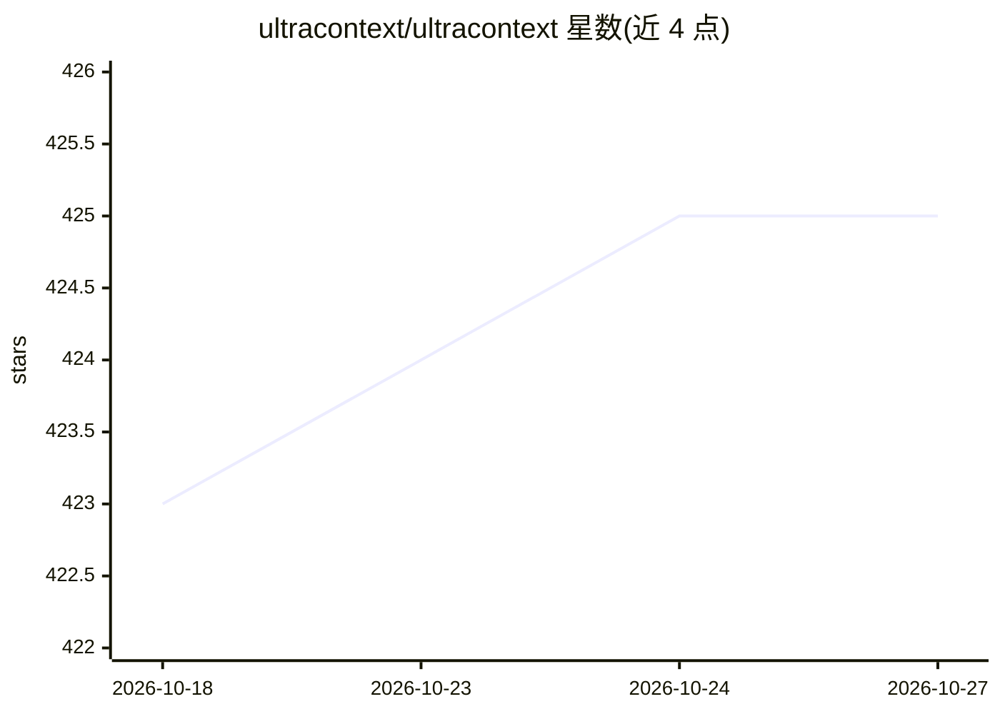

# ultracontext/ultracontext

⭐ 425 · JavaScript · Apache-2.0 · 推送 2026-10-25 · [GitHub](https://github.com/ultracontext/ultracontext) · [官网](https://ultracontext.com) · 组织维护

**多 AI agent 间实时捕获与共享上下文的开源基础设施**

面向使用多个 AI coding agent 的开发者：通过 CLI 守护进程实时捕获 Claude Code、Codex、OpenClaw 等会话的上下文，并提供终端 dashboard 展示。内置 MCP Server 使任一 agent 可访问其他 agent 的上下文，支持跨工具继续会话。另提供类 git 原语的 Context API（创建/获取/追加/更新/删除五种方法、自动版本化、时间旅行），有 JS/TS 与 Python SDK。要求 Node >= 22，npm 全局安装 CLI。

## 筛选速览

| 维度 | 判定 | 备注 |
|---|---|---|
| AI 角色 | `ai-ecosystem` | LLM/agent 周边工具 |
| 许可风险 | `permissive` | Apache-2.0 |
| 部署形态 | `library` | 以包/库形式分发 |
| 模型依赖 | — | README 未给出锁定关系 |
| 硬件要求 | — | 无带数字的原话,不猜 |
| 安装摩擦 | `low` | 无编译、无系统依赖或容器化 |
| 成熟度 | — | 结构信号不足 |

## 能力要点

- CLI 自动摄取 Claude Code、Codex、OpenClaw 会话并附终端 dashboard
- MCP Server 可内置于 API 或经 stdio 独立运行，跨 agent 共享上下文
- 类 git 的 Context API：五种方法、自动版本化、历史时间旅行
- 框架无关，提供 JavaScript/TypeScript 与 Python SDK

## 适用场景

- 在 Claude Code 开始的会话切换到 Codex 继续
- 询问团队成员当前 agent 正在做什么
- 用 Context API 自建或扩展现有 agent 的上下文管理

## 场景标签

`Agent 记忆` · 领域:Agent 开发

## 证据(README 行号)

> L38: UltraContext captures every agent's context in realtime and makes it available to all of them. It's like having a p
> L53: |Context API|Git-like context engineering API. Store, version, and retrieve agent context with zero complexity.|

## 星数曲线

2026-10-18 423 → 2026-10-27 425（+2）

---
*卡片 v1 · prompt 1.4 · 生成 2026-10-21 · 置信度 high · 依据 README sha `39a53c5103d0` · [字段定义](../../DATASET.md)*
