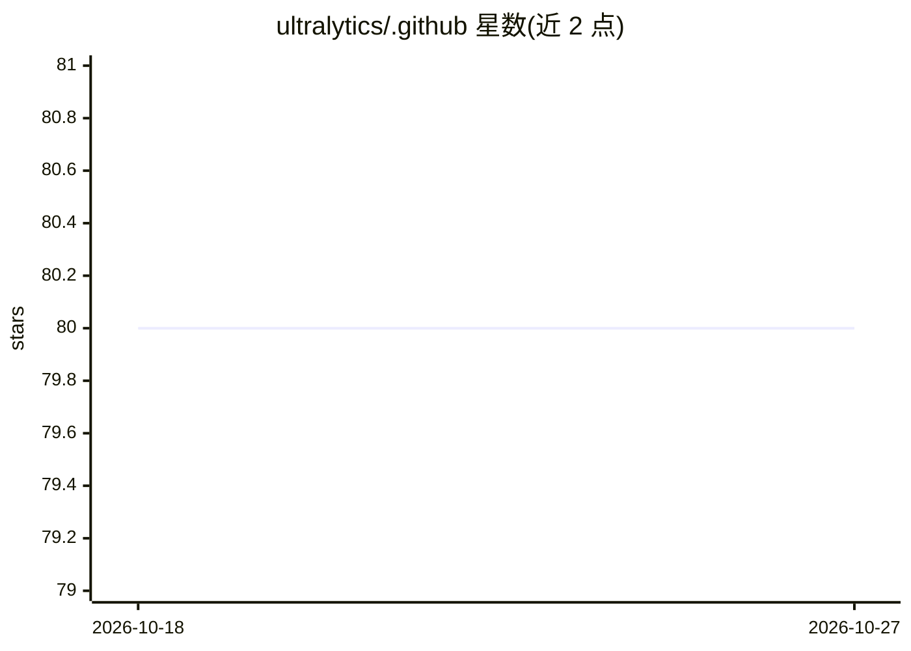

# ultralytics/.github

⭐ 80 · AGPL-3.0 · 推送 2026-09-16 · [GitHub](https://github.com/ultralytics/.github) · [官网](https://ultralytics.com) · 组织维护

**Ultralytics 组织级 GitHub 社区健康文件与模板仓库**

该仓库存放 Ultralytics 组织范围内的 GitHub 社区健康文件：Issue 模板、Pull Request 模板、贡献指南、GitHub Actions 工作流以及公开的组织主页配置，用于在各 Ultralytics 项目间标准化社区协作流程。面向 Ultralytics 团队成员（作为新仓库默认模板）和社区贡献者（提交 Issue/PR 前查阅指南）。仓库本身不含模型代码，内容以 AGPL-3.0 发布。

## 筛选速览

| 维度 | 判定 | 备注 |
|---|---|---|
| AI 角色 | `ai-knowledge` | 知识聚合/清单类 |
| 许可风险 | `dual` | AGPL-3.0 |
| 部署形态 | `None` |  |
| 模型依赖 | — | README 未给出锁定关系 |
| 硬件要求 | — | 无带数字的原话,不猜 |
| 安装摩擦 | `low` | 无编译、无系统依赖或容器化 |
| 成熟度 | — | 结构信号不足 |

## 能力要点

- 提供 Issue 与 Pull Request 结构化模板
- 组织级共享的 GitHub Actions 工作流
- 统一的贡献指南，覆盖全部 Ultralytics 项目

## 适用场景

- 向 Ultralytics 各项目提交 Issue 或 PR 时使用对应模板
- Ultralytics 团队成员为新仓库套用默认社区健康文件
- 了解 Ultralytics 组织的社区协作规范

## 场景标签

 · 领域:开源社区治理/AI 组织基础设施

## 证据(README 行号)

> L14: The `.github` repository is a special GitHub feature that helps standardize interactions across all Ultralytics pro
> L17: - **Issue Templates**: Structured templates designed to improve the clarity and completeness of issue reports. This

## 星数曲线

2026-10-18 80 → 2026-10-27 80（+0）

---
*卡片 v1 · prompt 1.4 · 生成 2026-10-24 · 置信度 mid · 依据 README sha `ca80eda42bf5` · [字段定义](../../DATASET.md)*
