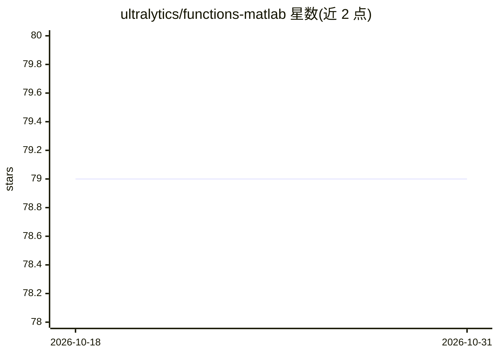

# ultralytics/functions-matlab

⭐ 79 · MATLAB · AGPL-3.0 · 推送 2026-09-27 · [GitHub](https://github.com/ultralytics/functions-matlab) · [官网](https://ultralytics.com) · 组织维护

**Ultralytics 生态共享的 MATLAB 工具函数库**

由 Ultralytics 维护的 MATLAB 函数集合，汇集科学计算、机器学习、数据分析、几何、信号处理与可视化等项目中复用的基础函数，作为跨项目代码复用与保持 MATLAB 代码库一致性的构件。使用需 MATLAB R2018a 或更新版本；安装方式为 git clone 后将目录加入 MATLAB path，即可像内置函数一样直接调用，具体用法见各 .m 文件内注释。提供 AGPL-3.0 与企业双许可选项。

## 筛选速览

| 维度 | 判定 | 备注 |
|---|---|---|
| AI 角色 | `ai-ecosystem` | LLM/agent 周边工具 |
| 许可风险 | `dual` | AGPL-3.0 |
| 部署形态 | `None` |  |
| 模型依赖 | — | README 未给出锁定关系 |
| 硬件要求 | — | 无带数字的原话,不猜 |
| 安装摩擦 | `low` | 无编译、无系统依赖或容器化 |
| 成熟度 | — | 结构信号不足 |

## 能力要点

- 覆盖科学计算、机器学习、几何、信号处理、可视化等领域的复用函数
- git clone 后 addpath 即可像内置函数一样调用
- 要求 MATLAB R2018a 或更新版本
- AGPL-3.0 与企业双许可

## 适用场景

- 在 MATLAB 项目中复用 Ultralytics 生态的通用工具函数
- 研究与开发阶段的数据分析和可视化辅助计算
- 保持多个 MATLAB 项目间函数实现的一致性

## 场景标签

 · 领域:科学计算/机器学习工具库

## 证据(README 行号)

> L5: Welcome to the Ultralytics MATLAB Functions Repository! This repository serves as a central hub for commonly used fu
> L16: The functions-matlab repository is a curated collection of MATLAB functions frequently employed within the Ultralyt

## 星数曲线

2026-10-18 79 → 2026-10-31 79（+0）

---
*卡片 v1 · prompt 1.4 · 生成 2026-10-24 · 置信度 high · 依据 README sha `dbd44f5f0f8f` · [字段定义](../../DATASET.md)*
