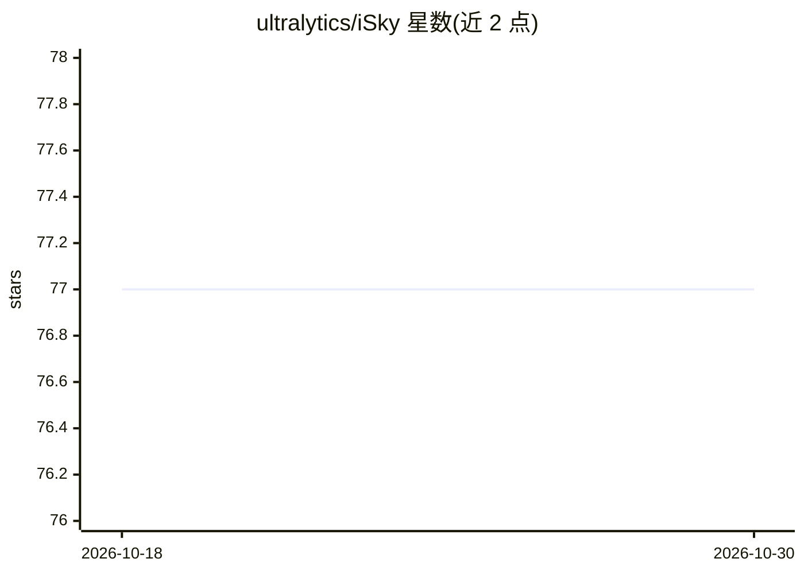

# ultralytics/iSky

⭐ 77 · Swift · AGPL-3.0 · 推送 2026-08-28 · [GitHub](https://github.com/ultralytics/iSky) · [官网](https://apps.apple.com/us/app/isky/id1445737240) · 组织维护 · 中文 README

**iOS 实时风格迁移相机应用：五种名画风格处理实时视频**

Ultralytics 开发的 iPhone/iPad 应用，使用 Core ML 风格迁移模型对设备摄像头实时视频做风格化处理，提供梵高星空、马赛克、Rain Princess、Candie、Udnie 五种风格，点击屏幕切换，支持暂停/播放与画面分享。源码以 Xcode 工程形式提供，需自行获取五个 .mlmodel 模型文件后编译安装，iOS 12.0+，App Store 提供发行版。采用 AGPL-3.0 与企业双许可。

## 筛选速览

| 维度 | 判定 | 备注 |
|---|---|---|
| AI 角色 | `ai-native` | 本体是模型或模型工具 |
| 许可风险 | `dual` | AGPL-3.0 |
| 部署形态 | `None` |  |
| 模型依赖 | — | README 未给出锁定关系 |
| 硬件要求 | — | 无带数字的原话,不猜 |
| 安装摩擦 | `low` | 无编译、无系统依赖或容器化 |
| 成熟度 | — | 结构信号不足 |

## 能力要点

- Core ML 风格迁移模型实时处理摄像头视频
- 五种绘画风格一键切换
- 支持暂停/播放与画面分享
- App Store 提供发行版，亦可从源码用 Xcode 构建

## 适用场景

- 用名画风格实时滤镜拍摄和创作视频画面
- iOS 上体验设备端实时神经风格迁移
- 学习 Core ML 与 Swift 的实时推理工程实现

## 场景标签

`图像视频处理` · 领域:感知与多模态

## 证据(README 行号)

> L10: Welcome to the Ultralytics iSky iOS App GitHub repository! 📖 This app leverages advanced neural network style-trans

## 星数曲线

2026-10-18 77 → 2026-10-30 77（+0）

---
*卡片 v1 · prompt 1.4 · 生成 2026-10-24 · 置信度 high · 依据 README sha `a38d51f09468` · [字段定义](../../DATASET.md)*
