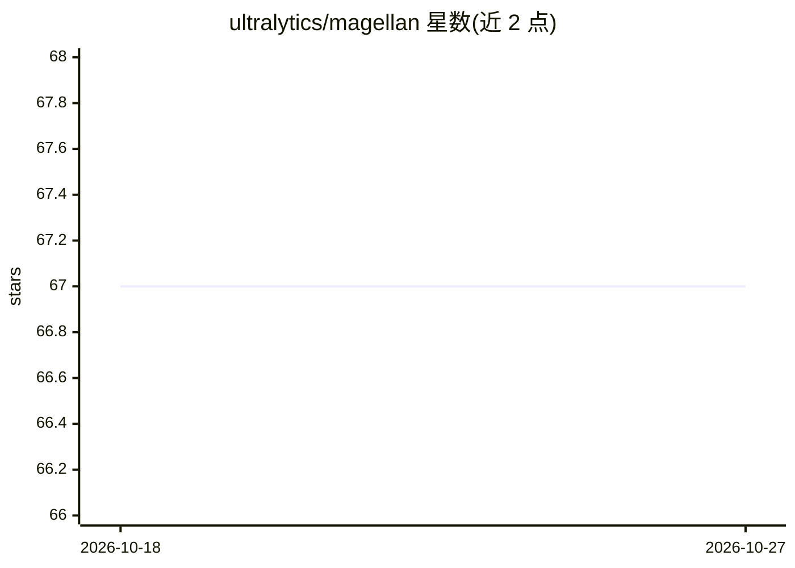

# ultralytics/magellan

⭐ 67 · MATLAB · AGPL-3.0 · 推送 2026-08-28 · [GitHub](https://github.com/ultralytics/magellan) · [官网](https://ultralytics.com) · 组织维护

**MATLAB 机器学习地球观测与中子制图工具集**

Ultralytics 维护的 MATLAB 开源仓库，将机器学习用于地球观测与地理空间数据分析，覆盖中子通量制图（NMDB 工作流）、MCNP 地图分析，并支持将 ML 结果叠加到 Google Maps 和 WebGL Earth 上进行可视化交互。运行需 MATLAB R2018a 或更高版本，且需 Statistics and Machine Learning、Signal Processing、Deep Learning 三个工具箱，另需克隆 functions-matlab 公共函数库并加入路径。以源码仓库形式提供，入门从运行 MAGELLAN 示例开始。

## 筛选速览

| 维度 | 判定 | 备注 |
|---|---|---|
| AI 角色 | `ai-native` | 本体是模型或模型工具 |
| 许可风险 | `dual` | AGPL-3.0 |
| 部署形态 | `None` |  |
| 模型依赖 | — | README 未给出锁定关系 |
| 硬件要求 | — | 无带数字的原话,不猜 |
| 安装摩擦 | `low` | 无编译、无系统依赖或容器化 |
| 成熟度 | — | 结构信号不足 |

## 能力要点

- ML 与地球观测数据结合的中子制图（NMDB 工作流）
- MCNP 地图分析工作流（fcnMCNPmap）
- ML 结果可叠加 Google Maps 与 WebGL Earth 可视化
- 基于 MATLAB，需三个官方工具箱支持

## 适用场景

- 科研人员对中子观测数据做 ML 建模并生成地图
- 将地理空间 ML 分析结果在地图平台上可视化
- 复用 MATLAB 工作流做遥感/地球观测分析

## 场景标签

`科研工具` · 领域:学习与行业

## 证据(README 行号)

> L5: Welcome to the Ultralytics open-source Earth observation repository! This space showcases innovative software develo
> L14: The Ultralytics Magellan Project pioneers the integration of **ML** with Earth observation data. This project enabl

## 星数曲线

2026-10-18 67 → 2026-10-27 67（+0）

---
*卡片 v1 · prompt 1.4 · 生成 2026-10-24 · 置信度 high · 依据 README sha `22b26ebaacb1` · [字段定义](../../DATASET.md)*
