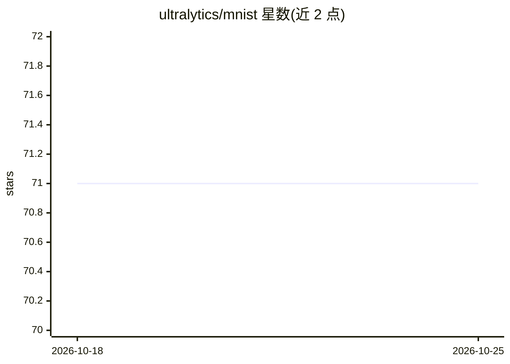

# ultralytics/mnist

⭐ 71 · Python · AGPL-3.0 · 推送 2026-08-28 · [GitHub](https://github.com/ultralytics/mnist) · [官网](https://ultralytics.com) · 组织维护

**MNIST 手写数字数据集上的卷积网络实验沙盒**

Ultralytics 维护的 PyTorch 实验仓库：在 MNIST 手写数字数据集上训练和测试卷积网络、ResNet 等神经网络架构。默认 train.py 训练 ConvNetb 20 个 epoch，读取自带的 MATLAB .mat 格式训练/测试文件（源自 Yann LeCun 的 MNIST 数据库）；另提供 train_resnet.py、train_sandd.py、train_xview_classes.py 等实验入口。需要 Python 3.7+，依赖 numpy、scipy、torch、torchvision、opencv-python、h5py、tqdm，通过 pip 安装 requirements.txt 后运行。采用 AGPL-3.0 与企业双许可模式。

## 筛选速览

| 维度 | 判定 | 备注 |
|---|---|---|
| AI 角色 | `ai-native` | 本体是模型或模型工具 |
| 许可风险 | `dual` | AGPL-3.0 |
| 部署形态 | `library` | 以包/库形式分发 |
| 模型依赖 | — | README 未给出锁定关系 |
| 硬件要求 | — | 无带数字的原话,不猜 |
| 安装摩擦 | `low` | 无编译、无系统依赖或容器化 |
| 成熟度 | — | 结构信号不足 |

## 能力要点

- 在 MNIST 上训练卷积网络、ResNet 等多种架构
- 默认脚本训练 ConvNetb 20 个 epoch，使用自带 .mat 数据文件
- 提供 train_resnet.py / train_sandd.py / train_xview_classes.py 等实验入口

## 适用场景

- 在手写数字数据集上快速试验不同网络结构
- 作为卷积网络与 ResNet 的学习/教学实验代码
- 对比多种架构在 MNIST 上的训练表现

## 场景标签

`目标检测` `教程课程` · 领域:学习与行业

## 证据(README 行号)

> L14: The repository at https://github.com/ultralytics/mnist is our dedicated playground for the MNIST dataset. 🖐 This re
> L39: The default script trains `ConvNetb` for 20 epochs using the bundled `data/MNISTtrain.mat` and `data/MNISTtest.mat`

## 星数曲线

2026-10-18 71 → 2026-10-25 71（+0）

---
*卡片 v1 · prompt 1.4 · 生成 2026-10-24 · 置信度 high · 依据 README sha `6029df59e711` · [字段定义](../../DATASET.md)*
