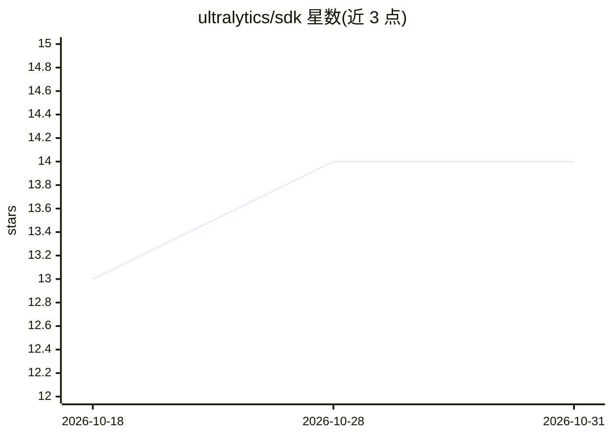

# ultralytics/sdk

⭐ 14 · Python · AGPL-3.0 · 推送 2026-10-30 · [GitHub](https://github.com/ultralytics/sdk) · [官网](https://platform.ultralytics.com/api/docs) · 组织维护 · 中文 README

**Ultralytics 平台 API 的类型化官方 Python SDK**

从固定版本 Ultralytics OpenAPI 契约生成的类型化 SDK，用于访问 Ultralytics Platform API：提供同步与异步客户端、类型化响应、multipart 上传、临时故障重试与结构化 API 错误。凭证解析顺序为显式 api_key、环境变量、保存的设置。包含统一 `ul` CLI，可提交云端 YOLO 训练/推理任务（如 `ul cloud train`）。要求 Python >=3.11，仅依赖 httpx，不安装 ultralytics 包；TypeScript/Go/Java SDK 标注为 Coming soon。AGPL-3.0 许可，另提供商业许可。

## 筛选速览

| 维度 | 判定 | 备注 |
|---|---|---|
| AI 角色 | `ai-ecosystem` | LLM/agent 周边工具 |
| 许可风险 | `dual` | AGPL-3.0 |
| 部署形态 | `library` | 以包/库形式分发 |
| 模型依赖 | — | README 未给出锁定关系 |
| 硬件要求 | — | 无带数字的原话,不猜 |
| 安装摩擦 | `low` | 无编译、无系统依赖或容器化 |
| 成熟度 | — | 结构信号不足 |

## 能力要点

- OpenAPI 契约固定快照生成，CI 校验契约一致性与生成漂移
- 同步/异步客户端，支持类型化响应、multipart 上传、重试与结构化错误
- 统一 `ul` CLI 提交云端训练与推理（`ul cloud train/predict`）
- 仅一个轻量依赖 httpx，不安装 ultralytics 本体

## 适用场景

- 在 Python 代码中调用 Ultralytics Platform 的训练与推理 API
- 用 `ul cloud` 命令提交 YOLO 云端训练并自动上传权重与数据集
- 构建需要类型化 API 客户端的计算机视觉自动化流水线

## 场景标签

 · 领域:计算机视觉/开发者工具

## 证据(README 行号)

> L13: Typed SDKs for the Ultralytics Platform API, generated from a pinned contract with Ultralytics OpenAPI. The interac
> L25: The package includes the unified `ul` CLI for local YOLO and Platform SDK commands; see the CLI guide. Maintain `cl

## 星数曲线

2026-10-18 13 → 2026-10-31 14（+1）

---
*卡片 v1 · prompt 1.4 · 生成 2026-10-31 · 置信度 high · 依据 README sha `4fdaada159e2` · [字段定义](../../DATASET.md)*
