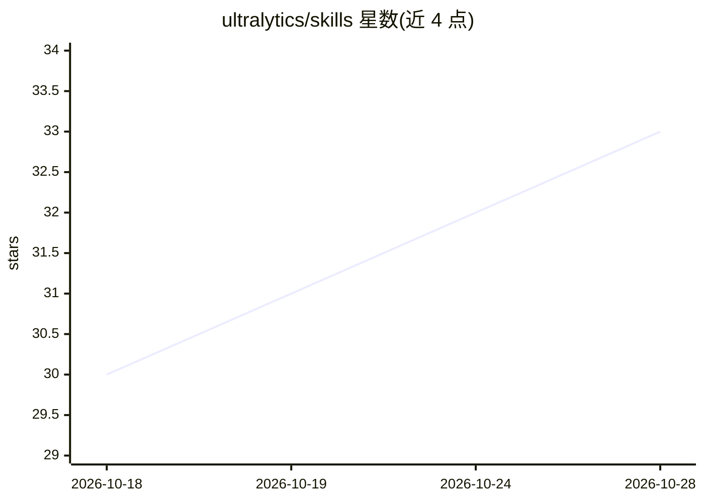

# ultralytics/skills

⭐ 33 · AGPL-3.0 · 推送 2026-10-22 · [GitHub](https://github.com/ultralytics/skills) · [官网](https://www.ultralytics.com) · 组织维护 · 中文 README

**教 AI 编程代理使用 Ultralytics YOLO 的技能文件集**

Ultralytics 官方维护的 Agent Skills 仓库：以 8 个 SKILL.md（yolo、models、datasets、training、tuning、inference、export、platform-cli）覆盖计算机视觉全生命周期——数据标注、训练调参、推理跟踪、导出部署，面向 Claude Code、Codex、Cursor 等支持 Agent Skills 格式的编码代理。技能内容基于 ultralytics v8.4.174 与平台文档，运行时以已安装版本为准；插件本身只含指令，加载时不执行任何代码。提供 Claude/Codex 插件市场与 npx 安装方式。

## 筛选速览

| 维度 | 判定 | 备注 |
|---|---|---|
| AI 角色 | `ai-knowledge` | 知识聚合/清单类 |
| 许可风险 | `dual` | AGPL-3.0 |
| 部署形态 | `self-host` | docker 或自建部署 |
| 模型依赖 | — | README 未给出锁定关系 |
| 硬件要求 | — | 无带数字的原话,不猜 |
| 安装摩擦 | `low` | 无编译、无系统依赖或容器化 |
| 成熟度 | — | 结构信号不足 |

## 能力要点

- 8 个按生命周期划分的技能（模型/数据集/训练/调优/推理/导出/平台 CLI）
- 内容基于 ultralytics v8.4.174，运行时以 yolo checks/cfg 实际版本为准
- 支持 Claude Code 插件市场、Codex 插件、npx skills 三种安装途径
- 插件仅含指令文本，加载时不执行代码

## 适用场景

- 让 Claude Code/Codex/Cursor 等代理正确调用 yolo CLI 与 Python API
- 训练和导出 YOLO 模型时代理给出准确的参数与权重名
- 用 ul cloud 脚本化操作 Ultralytics Platform 资源

## 场景标签

`目标检测` `模型训练` · 领域:感知与多模态

## 证据(README 行号)

> L7: Agent skills for Ultralytics Platform, the `ultralytics` Python package, and the `yolo` CLI. They teach AI coding ag
> L26: Each skill is a `SKILL.md` of procedures, decision tables, and gotchas, with Codex and ChatGPT presentation metadat

## 星数曲线

2026-10-18 30 → 2026-10-28 33（+3）

---
*卡片 v1 · prompt 1.4 · 生成 2026-10-25 · 置信度 mid · 依据 README sha `2eb3c5c0eda0` · [字段定义](../../DATASET.md)*
