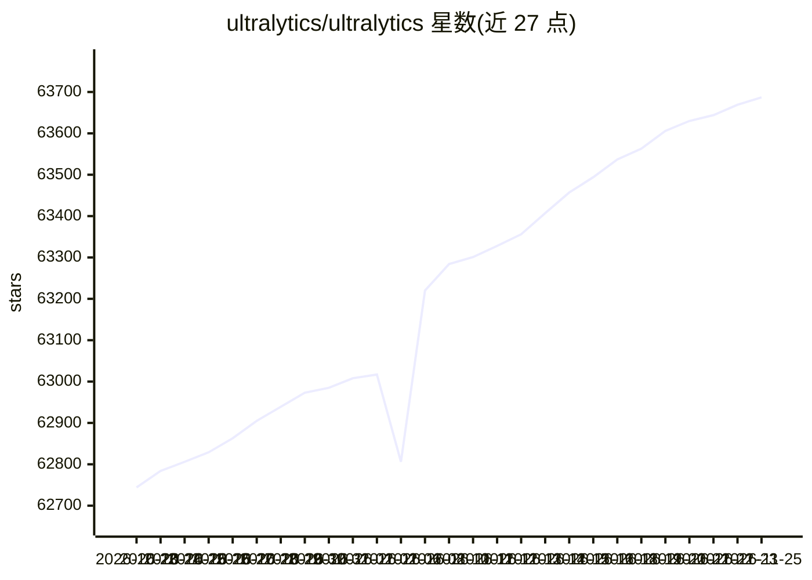

# ultralytics/ultralytics

⭐ 63,687 · Python · AGPL-3.0 · 推送 2026-11-24 · [GitHub](https://github.com/ultralytics/ultralytics) · [官网](https://platform.ultralytics.com) · 组织维护

**给开发者的多任务视觉模型库：检测/分割/姿态等**

Ultralytics 提供的 YOLO 系列模型库（YOLOv3 至 YOLO26），支持目标检测、实例分割、语义分割、深度估计、图像分类、姿态估计与目标跟踪任务。通过 `pip install ultralytics` 安装后，可用 `yolo` CLI 命令或 Python API 加载预训练模型执行预测、训练与验证；预训练权重在首次使用时自动从 Ultralytics 发布版本下载。README 附带 COCO、Cityscapes、ImageNet、DOTAv1 等数据集预训练模型的指标表。商业使用需申请企业许可。

## 筛选速览

| 维度 | 判定 | 备注 |
|---|---|---|
| AI 角色 | `ai-native` | 本体是模型或模型工具 |
| 许可风险 | `dual` | AGPL-3.0 |
| 部署形态 | `self-host` | docker 或自建部署 |
| 模型依赖 | — | README 未给出锁定关系 |
| 硬件要求 | — | 无带数字的原话,不猜 |
| 安装摩擦 | `low` | 无编译、无系统依赖或容器化 |
| 成熟度 | — | 结构信号不足 |

## 动量与使用信号

- 维护:`active` — 距上次 push 0.6 天,年发版 100,467 位贡献者
- 涨星:近 1 天 **+32**(自 20261016 起算)
- 安装:pypi 包 `ultralytics` 月下载 4,182,818

## 能力要点

- 支持检测、分割、深度估计、分类、姿态估计、OBB 与跟踪等任务
- 提供 CLI（yolo 命令）与 Python API 两种使用方式
- 支持 PyPI、Conda、Docker、Git 源码多种安装方式
- YOLO26 预训练模型覆盖 COCO/Cityscapes/ImageNet/DOTAv1 等数据集

## 适用场景

- 在图像或视频中做目标检测与跨帧跟踪
- 训练自定义数据集的分割或姿态估计模型
- 用预训练模型直接做图像分类或深度估计

## 场景标签

`目标检测` · 领域:感知与多模态

## 证据(README 行号)

> L19: Ultralytics creates cutting-edge, state-of-the-art (SOTA) YOLO models built on years of foundational research in co
> L49: Install the `ultralytics` package, including all requirements, in a **Python>=3.8** environment with **PyTorch>=1.8

## 星数曲线

2026-10-23 62,744 → 2026-11-25 63,687（+943）

---
*卡片 v1 · prompt 1.4 · 生成 2026-11-22 · 置信度 high · 依据 README sha `2926ed7118bf` · [字段定义](../../DATASET.md)*
