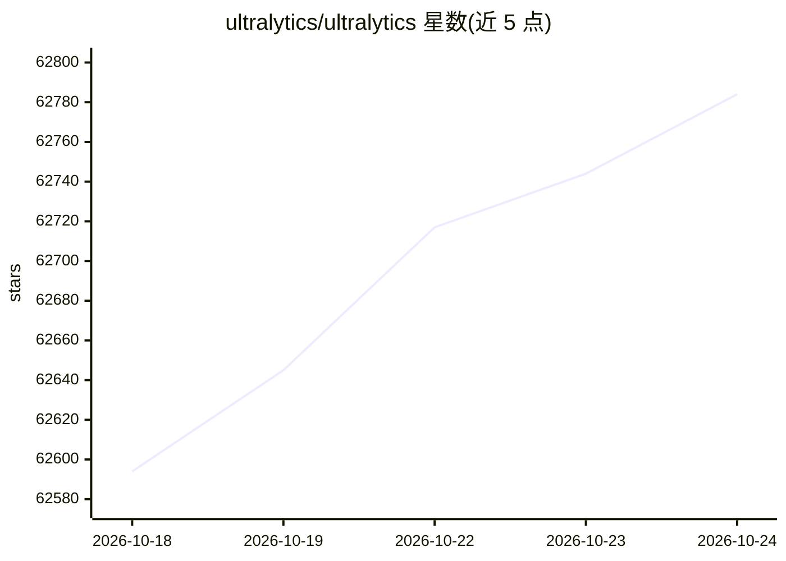

# ultralytics/ultralytics

⭐ 62,806 · Python · AGPL-3.0 · 推送 2026-10-24 · [GitHub](https://github.com/ultralytics/ultralytics) · [官网](https://platform.ultralytics.com) · 组织维护

**YOLO 系列视觉模型库：检测/分割/分类/姿态/跟踪一体化**

Ultralytics 维护的 YOLO 模型库，覆盖目标检测、实例分割、语义分割、深度估计、图像分类、姿态估计、旋转框检测与多帧目标跟踪任务。通过 pip 安装后提供 CLI（yolo 命令）与 Python API 两种调用方式，预训练权重在首次使用时自动从官方 release 下载。模型在 COCO、Cityscapes、ImageNet、DOTAv1、NYU Depth V2 等数据集上预训练，README 附带各系列模型的精度与速度指标表。商业使用需向官方申请 Enterprise License。

## 筛选速览

| 维度 | 判定 | 备注 |
|---|---|---|
| AI 角色 | `ai-ecosystem` | LLM/agent 周边工具 |
| 许可风险 | `dual` | AGPL-3.0 |
| 部署形态 | `self-host` | docker 或自建部署 |
| 模型依赖 | — | README 未给出锁定关系 |
| 硬件要求 | — | 无带数字的原话,不猜 |
| 安装摩擦 | `low` | 无编译、无系统依赖或容器化 |
| 成熟度 | — | 结构信号不足 |

## 动量与使用信号

- 维护:`active` — 距上次 push 0.6 天,年发版 100,467 位贡献者
- 涨星:近 1 天 **+32**(自 20261016 起算)
- 安装:pypi 包 `ultralytics` 月下载 4,182,818

## 能力要点

- 支持检测、分割、深度估计、分类、姿态、OBB、跟踪七类视觉任务
- CLI（yolo 命令）与 Python API 两种调用方式
- 预训练权重首次使用时自动下载，含 COCO/Cityscapes/ImageNet/DOTA/NYU 等预训练版本
- 提供 YOLO27 预告（尚未发布，无发布日期）

## 适用场景

- 在图像/视频上做目标检测与实例分割
- 训练自定义数据集的视觉模型
- 对检测/分割/姿态结果做跨帧目标跟踪
- 在 CPU 或 GPU 上部署推理

## 场景标签

`目标检测` · 领域:感知与多模态

## 证据(README 行号)

> L19: Ultralytics creates cutting-edge, state-of-the-art (SOTA) YOLO models built on years of foundational research in co
> L43: ## 📄 Documentation
> L91: Ultralytics supports a wide range of YOLO models, from early versions like YOLOv3 to the latest YOLO26. The tables 

## 星数曲线

2026-10-18 62,594 → 2026-10-24 62,784（+190）

---
*卡片 v1 · prompt 1.4 · 生成 2026-10-18 · 置信度 mid · 依据 README sha `e89f57429c97` · [字段定义](../../DATASET.md)*
