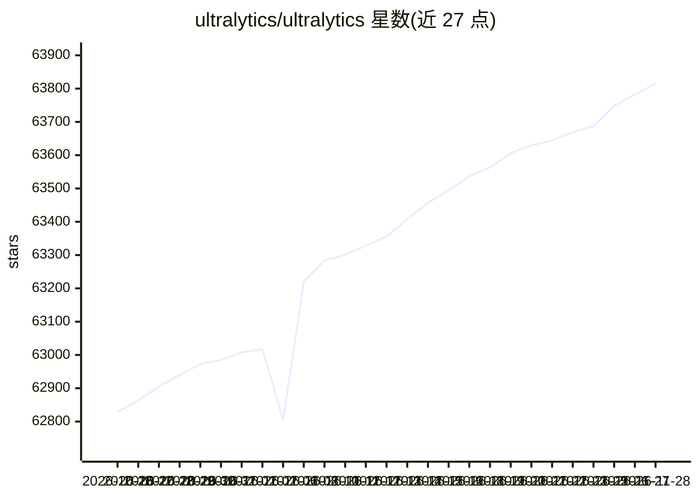

# ultralytics/ultralytics

⭐ 63,815 · Python · AGPL-3.0 · 推送 2026-11-27 · [GitHub](https://github.com/ultralytics/ultralytics) · [官网](https://platform.ultralytics.com) · 组织维护

**给开发者用的目标检测等多任务视觉模型库**

Ultralytics 的 YOLO 系列模型 Python 包，覆盖目标检测、实例/语义分割、深度估计、图像分类、姿态估计、OBB 与多目标跟踪等任务，按 COCO、ImageNet、Cityscapes、DOTAv1 等数据集提供预训练权重，首次使用自动下载。提供 CLI（yolo 命令）与 Python API 两种调用方式，支持训练、验证、预测、部署流程。安装要求 Python>=3.8、PyTorch>=1.8；商业使用需申请 Enterprise License。

## 筛选速览

| 维度 | 判定 | 备注 |
|---|---|---|
| AI 角色 | `ai-native` | 本体是模型或模型工具 |
| 许可风险 | `dual` | AGPL-3.0 |
| 部署形态 | `self-host` | docker 或自建部署 |
| 模型依赖 | — | README 未给出锁定关系 |
| 硬件要求 | — | 无带数字的原话,不猜 |
| 安装摩擦 | `low` | 无编译、无系统依赖或容器化 |
| 成熟度 | — | 结构信号不足 |

## 动量与使用信号

- 维护:`active` — 距上次 push 0.6 天,年发版 100,467 位贡献者
- 涨星:近 1 天 **+32**(自 20261016 起算)
- 安装:pypi 包 `ultralytics` 月下载 4,182,818

## 能力要点

- CLI（yolo 命令）与 Python API 两种调用方式
- 覆盖检测、分割、深度估计、分类、姿态、OBB、跟踪等任务
- 预训练权重首次使用时自动下载
- 支持 pip/Conda/Docker/源码安装

## 适用场景

- 在图像/视频上运行目标检测与实例分割
- 训练自定义数据集的检测或分类模型
- 在 CPU 或 NVIDIA GPU/TensorRT 环境部署推理

## 场景标签

`目标检测` `模型训练` · 领域:感知与多模态

## 证据(README 行号)

> L19: Ultralytics creates cutting-edge, state-of-the-art (SOTA) YOLO models built on years of foundational research in co
> L49: Install the `ultralytics` package, including all requirements, in a **Python>=3.8** environment with **PyTorch>=1.8
> L65: You can use Ultralytics YOLO directly from the Command Line Interface (CLI) with the `yolo` command:

## 星数曲线

2026-10-26 62,829 → 2026-11-28 63,815（+986）

---
*卡片 v1 · prompt 1.4 · 生成 2026-11-26 · 置信度 high · 依据 README sha `d34ed4bb54cc` · [字段定义](../../DATASET.md)*
