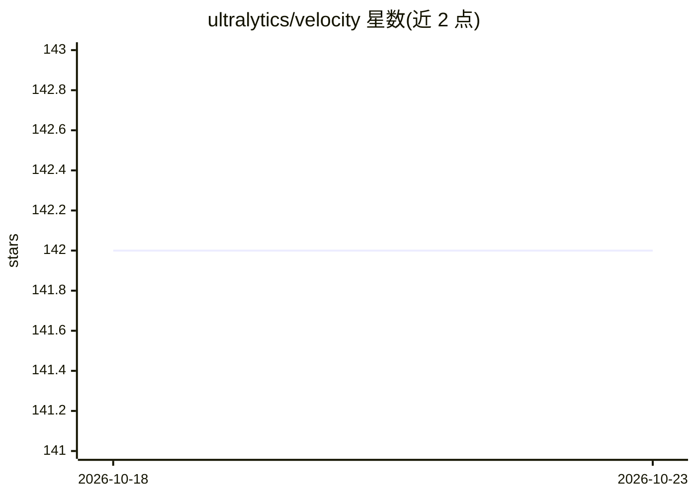

# ultralytics/velocity

⭐ 142 · Python · AGPL-3.0 · 推送 2026-08-28 · [GitHub](https://github.com/ultralytics/velocity) · [官网](https://www.ultralytics.com) · 组织维护

**基于 ML 与运动恢复结构的车辆测速研究工具库**

Ultralytics 维护的研究代码库，结合机器学习与 Structure-from-Motion 从图像序列估计车辆速度，面向交通监控、道路安全与自动驾驶系统研究。包含小型 data/ 示例集但非公开基准数据集，方法设计用于接入自定义数据。依赖 Python 3.7+（numpy/scipy/torch/opencv/exifread），部分脚本需 MATLAB 2018a+ 及其统计与信号处理工具箱；README 未给出具体运行命令，建议通过 Issue 获取指导。

## 筛选速览

| 维度 | 判定 | 备注 |
|---|---|---|
| AI 角色 | `ai-native` | 本体是模型或模型工具 |
| 许可风险 | `dual` | AGPL-3.0 |
| 部署形态 | `library` | 以包/库形式分发 |
| 模型依赖 | — | README 未给出锁定关系 |
| 硬件要求 | — | 无带数字的原话,不猜 |
| 安装摩擦 | `low` | 无编译、无系统依赖或容器化 |
| 成熟度 | — | 结构信号不足 |

## 能力要点

- ML 与 SFM 结合的车辆速度估计方法集
- 附小型示例数据，支持接入自定义图像数据集
- Python 与 MATLAB 双语言脚本，提供 DOI 可引用

## 适用场景

- 交通监控场景下从图像估计车辆速度
- 道路安全分析中获取速度数据
- 自动驾驶相关研究的基线方法参考

## 场景标签

 · 领域:计算机视觉/交通

## 证据(README 行号)

> L5: Welcome to the Ultralytics Velocity repository! Here, we delve into the intersection of Machine Learning (ML) and St
> L11: This project aims to leverage advanced ML and SFM techniques to accurately estimate vehicle speeds from various for

## 星数曲线

2026-10-18 142 → 2026-10-23 142（+0）

---
*卡片 v1 · prompt 1.4 · 生成 2026-10-22 · 置信度 mid · 依据 README sha `d043b33815aa` · [字段定义](../../DATASET.md)*
