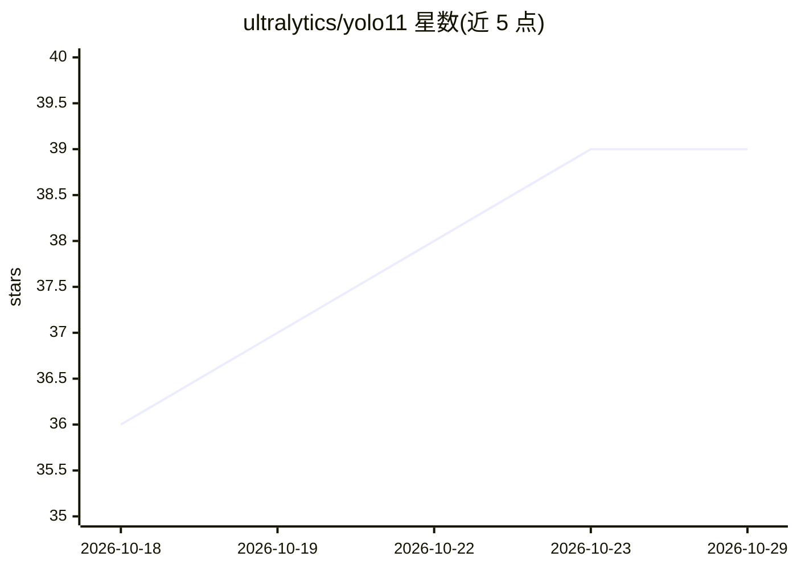

# ultralytics/yolo11

⭐ 39 · AGPL-3.0 · 推送 2026-09-16 · [GitHub](https://github.com/ultralytics/yolo11) · [官网](https://platform.ultralytics.com/ultralytics/yolo11) · 组织维护

**YOLO11 模型发现页：目标检测/分割/分类/姿态/旋转框/跟踪**

Ultralytics YOLO11 的轻量发现页（discovery page），规范的实现、发版与 issue 管理位于 ultralytics/ultralytics 仓库。YOLO11 通过官方 ultralytics Python 包提供，支持目标检测、实例分割、图像分类、姿态估计、旋转框检测与目标跟踪，覆盖训练、验证、预测与导出流程，Python>=3.8 且需 PyTorch。提供 n/s/m/l/x 五档权重，首次使用自动下载；支持 TensorRT、ONNX、CoreML、TFLite 等导出格式。

## 筛选速览

| 维度 | 判定 | 备注 |
|---|---|---|
| AI 角色 | `ai-native` | 本体是模型或模型工具 |
| 许可风险 | `dual` | AGPL-3.0 |
| 部署形态 | `library` | 以包/库形式分发 |
| 模型依赖 | — | README 未给出锁定关系 |
| 硬件要求 | — | 无带数字的原话,不猜 |
| 安装摩擦 | `low` | 无编译、无系统依赖或容器化 |
| 成熟度 | — | 结构信号不足 |

## 能力要点

- 检测/分割/分类/姿态/旋转框/跟踪六类任务，Python 与 CLI 两种工作流
- 五个尺寸档位（n/s/m/l/x）权重自动下载
- 支持 TensorRT、ONNX、CoreML、TFLite 等导出格式
- AGPL-3.0 与企业许可双许可选项

## 适用场景

- 训练或微调 YOLO11 完成检测、分割、姿态估计等视觉任务
- 将模型导出为 TensorRT/ONNX 等格式部署到边缘设备
- 用 CLI 一条命令对图片做预测

## 场景标签

`目标检测` · 领域:感知与多模态

## 证据(README 行号)

> L17: through the official Ultralytics YOLO package. It supports object
> L18: detection, instance segmentation, image classification, pose estimation, oriented object detection, and tracking in
> L21: This repository is a lightweight discovery page for YOLO11. The canonical implementation, package releases, model

## 星数曲线

2026-10-18 36 → 2026-10-29 39（+3）

---
*卡片 v1 · prompt 1.4 · 生成 2026-10-25 · 置信度 high · 依据 README sha `e88b17546587` · [字段定义](../../DATASET.md)*
