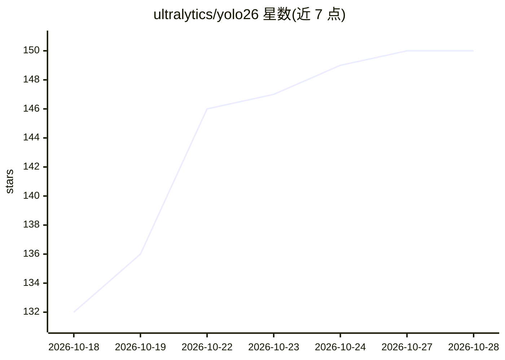

# ultralytics/yolo26

⭐ 151 · AGPL-3.0 · 推送 2026-09-16 · [GitHub](https://github.com/ultralytics/yolo26) · [官网](https://platform.ultralytics.com/ultralytics/yolo26) · 组织维护 · 中文 README

**Ultralytics YOLO26：多任务视觉模型，覆盖检测/分割/深度/姿态等**

Ultralytics YOLO26 官方发现页仓库：通过 ultralytics Python 包提供目标检测、实例与语义分割、深度估计、分类、姿态估计、旋转框检测与跟踪能力，支持 Python 与 CLI 工作流。本仓库为轻量介绍页，具体实现、包发布与 issue 管理位于 ultralytics/ultralytics 仓库。模型权重首次使用时自动下载，提供 n/s/m/l/x 五档规模，支持 TensorRT、ONNX、CoreML、TFLite 等导出格式。许可为 AGPL-3.0 与企业商业双轨。

## 筛选速览

| 维度 | 判定 | 备注 |
|---|---|---|
| AI 角色 | `ai-native` | 本体是模型或模型工具 |
| 许可风险 | `dual` | AGPL-3.0 |
| 部署形态 | `library` | 以包/库形式分发 |
| 模型依赖 | — | README 未给出锁定关系 |
| 硬件要求 | — | 无带数字的原话,不猜 |
| 安装摩擦 | `low` | 无编译、无系统依赖或容器化 |
| 成熟度 | — | 结构信号不足 |

## 能力要点

- 单模型家族覆盖 7 类视觉任务（检测/两种分割/深度/分类/姿态/OBB）
- Python 与 CLI 两种使用方式，pip 安装 ultralytics 包
- 模型权重首次使用时自动下载，n/s/m/l/x 五档规模
- 支持 TensorRT/ONNX/CoreML/TFLite 等导出格式

## 适用场景

- 我在图片或视频流上做目标检测与跟踪
- 我需要实例/语义分割、深度估计或姿态估计的预训练模型
- 我把训练好的模型导出到 ONNX/TensorRT 等格式部署到边缘设备

## 场景标签

`目标检测` · 领域:感知与多模态

## 证据(README 行号)

> L18: through the official Ultralytics YOLO package. It supports object
> L19: detection, instance segmentation, semantic segmentation, depth estimation, image classification, pose estimation,
> L20: oriented object detection, and tracking in a fast, accurate, and easy to use Python and CLI workflow.

## 星数曲线

2026-10-18 132 → 2026-10-28 150（+18）

---
*卡片 v1 · prompt 1.4 · 生成 2026-10-22 · 置信度 high · 依据 README sha `41285e7af6b6` · [字段定义](../../DATASET.md)*
