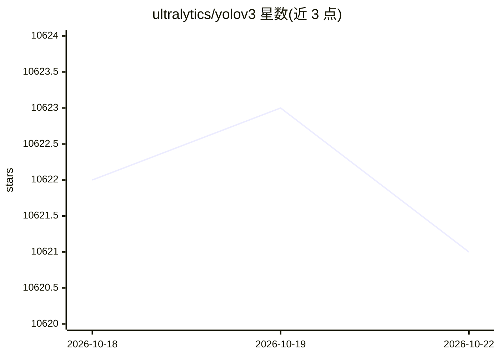

# ultralytics/yolov3

⭐ 10,621 · Python · AGPL-3.0 · 推送 2026-10-21 · [GitHub](https://github.com/ultralytics/yolov3) · [官网](https://docs.ultralytics.com/models/yolov3/) · 组织维护

**给开发者的 YOLOv3 目标检测 PyTorch 实现（训练/推理/导出）**

Ultralytics 维护的 YOLOv3、YOLOv3-SPP、YOLOv3-tiny 三个检测模型的 PyTorch 实现：将检测作为单次回归问题，一次前向直接输出边界框与类别概率。提供训练（COCO，可多 GPU）、验证、推理（支持摄像头/图片/视频等来源）与多格式导出（TorchScript、ONNX、OpenVINO、TensorRT、CoreML、PaddlePaddle），模型与数据集首次使用时自动下载，架构以 YAML 声明式定义。AGPL-3.0 许可，商业用途需另购 Enterprise License。

## 筛选速览

| 维度 | 判定 | 备注 |
|---|---|---|
| AI 角色 | `ai-native` | 本体是模型或模型工具 |
| 许可风险 | `dual` | AGPL-3.0 |
| 部署形态 | `self-host` | docker 或自建部署 |
| 模型依赖 | — | README 未给出锁定关系 |
| 硬件要求 | — | 无带数字的原话,不猜 |
| 安装摩擦 | `low` | 无编译、无系统依赖或容器化 |
| 成熟度 | — | 结构信号不足 |

## 能力要点

- YOLOv3 / YOLOv3-SPP / YOLOv3-tiny 三个模型变体，COCO 预训练权重自动下载
- 支持训练、验证、推理与多格式导出（ONNX/TensorRT/CoreML 等）
- 架构以 models/*.yaml 声明式定义，可不经编写 Python 修改结构
- 支持 PyTorch Hub 加载、多 GPU 训练与 TTA/模型集成等技巧

## 适用场景

- 在自有数据集上训练目标检测模型
- 对图片、视频或摄像头流做实时目标检测推理
- 将模型导出为 ONNX/TensorRT 等格式部署到边缘设备

## 场景标签

`目标检测` `模型训练` · 领域:感知与多模态

## 证据(README 行号)

> L14: Ultralytics YOLOv3 is a PyTorch implementation of the YOLOv3 (You Only Look Once, version 3) real-time object detec
> L16: This repository packages the three classic YOLOv3 detection models — **YOLOv3**, **YOLOv3-SPP**, and **YOLOv3-tiny*
> L84: Validate accuracy with `python val.py --weights yolov3.pt --data coco.yaml`, and export to other formats (TorchScri

## 星数曲线

2026-10-18 10,622 → 2026-10-22 10,621（-1）

---
*卡片 v1 · prompt 1.4 · 生成 2026-10-20 · 置信度 high · 依据 README sha `40fc9547f7e0` · [字段定义](../../DATASET.md)*
