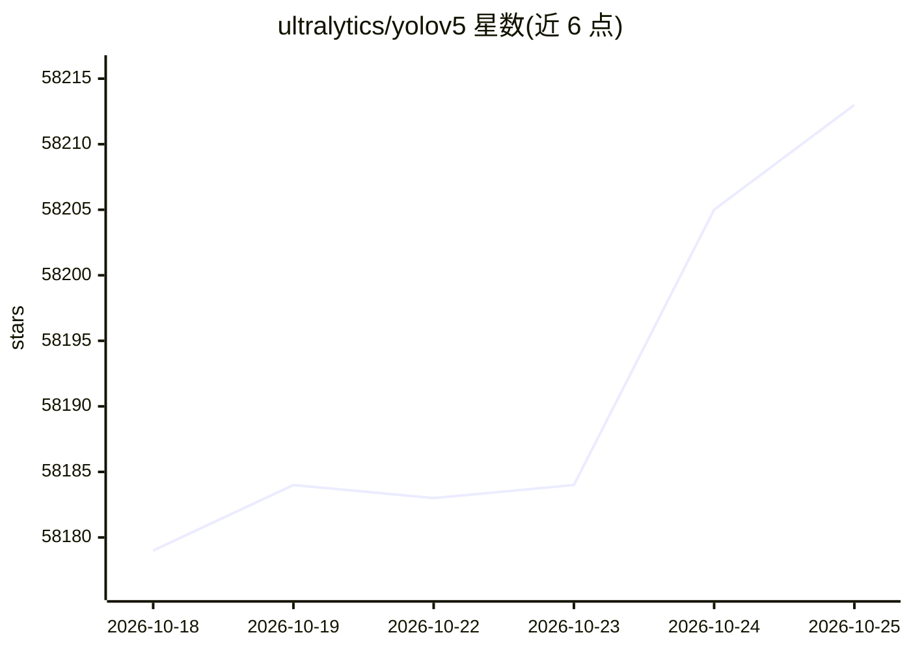

# ultralytics/yolov5

⭐ 58,213 · Python · AGPL-3.0 · 推送 2026-10-21 · [GitHub](https://github.com/ultralytics/yolov5) · [官网](https://docs.ultralytics.com/yolov5/) · 组织维护

**基于 PyTorch 的目标检测/实例分割/分类模型及训练导出工具**

Ultralytics 发布的 YOLOv5 视觉模型仓库：基于 PyTorch 框架，覆盖目标检测、实例分割与图像分类任务。提供 detect.py 推理脚本、PyTorch Hub 加载、train.py 训练（COCO 复现，n/s/m/l/x 五档模型），并支持导出 TFLite、ONNX、CoreML、TensorRT 等部署格式。安装需 Python>=3.8 与 PyTorch>=1.8，通过克隆仓库安装依赖；预训练权重从 release 自动下载。README 另提示最新任务（姿态估计、OBB）可使用 ultralytics 统一包。

## 筛选速览

| 维度 | 判定 | 备注 |
|---|---|---|
| AI 角色 | `ai-ecosystem` | LLM/agent 周边工具 |
| 许可风险 | `dual` | AGPL-3.0 |
| 部署形态 | `self-host` | docker 或自建部署 |
| 模型依赖 | local-ok | 支持本地模型 |
| 硬件要求 | — | 无带数字的原话,不猜 |
| 安装摩擦 | `low` | 无编译、无系统依赖或容器化 |
| 成熟度 | — | 结构信号不足 |

## 动量与使用信号

- 维护:`active` — 距上次 push 0.6 天,年发版 0,337 位贡献者
- 涨星:近 1 天 **-1**(自 20261016 起算)
- 安装:pypi 包 `ultralytics` 月下载 4,182,818

## 能力要点

- 目标检测、实例分割、图像分类三类任务的训练与推理
- 导出 TFLite/ONNX/CoreML/TensorRT 部署格式
- n/s/m/l/x 五档 COCO 预训练权重自动下载
- 多 GPU DDP 训练、TTA、模型剪枝与超参数演化教程

## 适用场景

- 在自己的数据集上训练目标检测模型
- 将检测/分割模型导出为 ONNX/TensorRT 部署到边缘设备（如 NVIDIA Jetson）
- 通过 PyTorch Hub 快速加载预训练模型做推理
- 复现 COCO 基准结果

## 场景标签

`目标检测` `模型训练` · 领域:感知与多模态

## 证据(README 行号)

> L14: Ultralytics YOLOv5 🚀 is a fast, accurate, and easy-to-use computer vision model developed by Ultralytics. Based on 
> L52: Clone the repository and install dependencies in a **Python>=3.8.0** environment. Ensure you have **PyTorch>=1.8** 
> L85: The commands below demonstrate how to reproduce YOLOv5 COCO dataset results. Both models and datasets are downloade

## 星数曲线

2026-10-18 58,179 → 2026-10-25 58,213（+34）

---
*卡片 v1 · prompt 1.4 · 生成 2026-10-18 · 置信度 mid · 依据 README sha `acb2217cdc38` · [字段定义](../../DATASET.md)*
