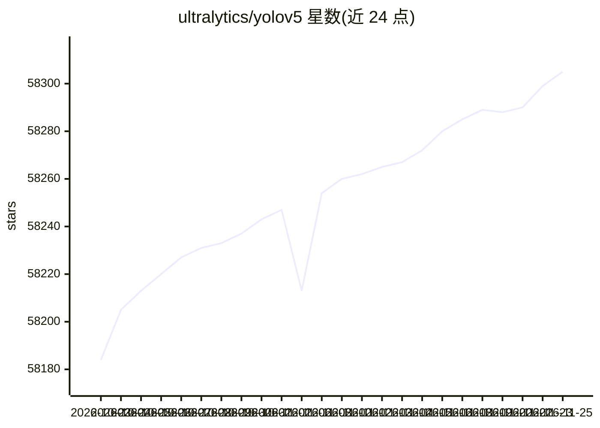

# ultralytics/yolov5

⭐ 58,305 · Python · AGPL-3.0 · 推送 2026-11-23 · [GitHub](https://github.com/ultralytics/yolov5) · [官网](https://docs.ultralytics.com/yolov5/) · 组织维护 · 中文 README

**基于 PyTorch 的目标检测/实例分割/分类模型库**

Ultralytics 的计算机视觉模型实现，支持目标检测、实例分割与图像分类的训练、验证、推理与导出。通过 detect.py 对摄像头、视频等多种来源推理，train.py 复现 COCO 结果，PyTorch Hub 加载预训练权重；export.py 支持 ONNX/TensorRT/CoreML/TFLite 导出，并提供 NVIDIA Jetson 部署教程。n/s/m/l/x 五档预训练权重在 COCO 上训练 300 epochs。安装需 Python>=3.8 与 PyTorch>=1.8；企业许可需另行申请。

## 筛选速览

| 维度 | 判定 | 备注 |
|---|---|---|
| AI 角色 | `ai-native` | 本体是模型或模型工具 |
| 许可风险 | `dual` | AGPL-3.0 |
| 部署形态 | `self-host` | docker 或自建部署 |
| 模型依赖 | — | README 未给出锁定关系 |
| 硬件要求 | — | 无带数字的原话,不猜 |
| 安装摩擦 | `low` | 无编译、无系统依赖或容器化 |
| 成熟度 | — | 结构信号不足 |

## 动量与使用信号

- 维护:`active` — 距上次 push 0.6 天,年发版 0,337 位贡献者
- 涨星:近 1 天 **-1**(自 20261016 起算)
- 安装:pypi 包 `ultralytics` 月下载 4,182,818

## 能力要点

- 提供 n/s/m/l/x 及 6/1280-pixel 预训练权重，mAP 与速度指标公开可复现
- v7.0 引入实例分割模型（segment/train.py、segment/val.py）
- export.py 导出 ONNX FP32、TensorRT FP16 等部署格式
- 集成 ClearML、Comet、W&B、Roboflow、Intel OpenVINO 等平台

## 适用场景

- 在自己的数据集上训练目标检测模型
- 用摄像头或视频流做实时检测推理
- 将模型导出为 ONNX/TensorRT 部署到 Jetson 等设备
- 训练实例分割模型并验证 mask mAP

## 场景标签

`目标检测` `模型训练` · 领域:感知与多模态

## 证据(README 行号)

> L14: Ultralytics YOLOv5 🚀 is a fast, accurate, and easy-to-use computer vision model developed by Ultralytics. Based on 
> L74: The `detect.py` script runs inference on various sources. It automatically downloads models from the latest YOLOv5 
> L85: The commands below demonstrate how to reproduce YOLOv5 COCO dataset results. Both models and datasets are downloade

## 星数曲线

2026-10-23 58,184 → 2026-11-25 58,305（+121）

---
*卡片 v1 · prompt 1.4 · 生成 2026-11-22 · 置信度 mid · 依据 README sha `8fb86fdacb8c` · [字段定义](../../DATASET.md)*
