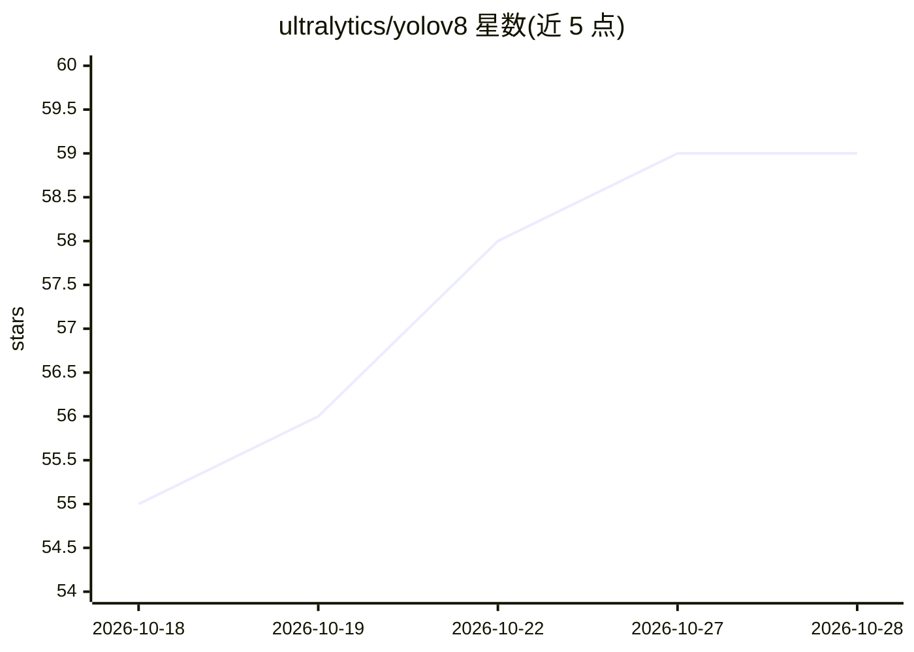

# ultralytics/yolov8

⭐ 59 · AGPL-3.0 · 推送 2026-09-16 · [GitHub](https://github.com/ultralytics/yolov8) · [官网](https://platform.ultralytics.com/ultralytics/yolov8) · 组织维护

**YOLOv8 模型的发现页：检测、分割、分类、姿态、OBB 与跟踪**

Ultralytics YOLOv8 官方 Python 包的轻量发现页：支持目标检测、实例分割、图像分类、姿态估计、旋转框检测与目标跟踪，以 Python 和 CLI 工作流运行，提供 pip 安装与 yolo 命令行预测示例。本仓库不含正式实现，代码、发布与 issue 均维护在 ultralytics/ultralytics 仓库。各规模模型权重（n/s/m/l/x）在首次使用时自动下载，支持导出 TensorRT、ONNX、CoreML、TFLite 等格式，采用 AGPL-3.0 与企业双许可。

## 筛选速览

| 维度 | 判定 | 备注 |
|---|---|---|
| AI 角色 | `ai-native` | 本体是模型或模型工具 |
| 许可风险 | `dual` | AGPL-3.0 |
| 部署形态 | `library` | 以包/库形式分发 |
| 模型依赖 | — | README 未给出锁定关系 |
| 硬件要求 | — | 无带数字的原话,不猜 |
| 安装摩擦 | `low` | 无编译、无系统依赖或容器化 |
| 成熟度 | — | 结构信号不足 |

## 能力要点

- 单一框架覆盖检测、分割、分类、姿态估计、旋转框检测与跟踪六类任务
- Python 与 CLI 两种使用方式，pip 一行安装
- n/s/m/l/x 五档模型权重首次使用自动下载
- 支持导出 TensorRT、ONNX、CoreML、TFLite 等格式

## 适用场景

- 训练或微调目标检测、分割、姿态估计等视觉模型
- 用 CLI 快速对图片执行预训练模型推理
- 将模型导出为部署格式接入生产环境

## 场景标签

`目标检测` `微调` · 领域:感知与多模态

## 证据(README 行号)

> L17: through the official Ultralytics YOLO package. It supports object
> L18: detection, instance segmentation, image classification, pose estimation, oriented object detection, and tracking in
> L61: yolo predict model=yolov8n.pt source="https://ultralytics.com/images/bus.jpg"

## 星数曲线

2026-10-18 55 → 2026-10-28 59（+4）

---
*卡片 v1 · prompt 1.4 · 生成 2026-10-24 · 置信度 high · 依据 README sha `4337ad9d872f` · [字段定义](../../DATASET.md)*
