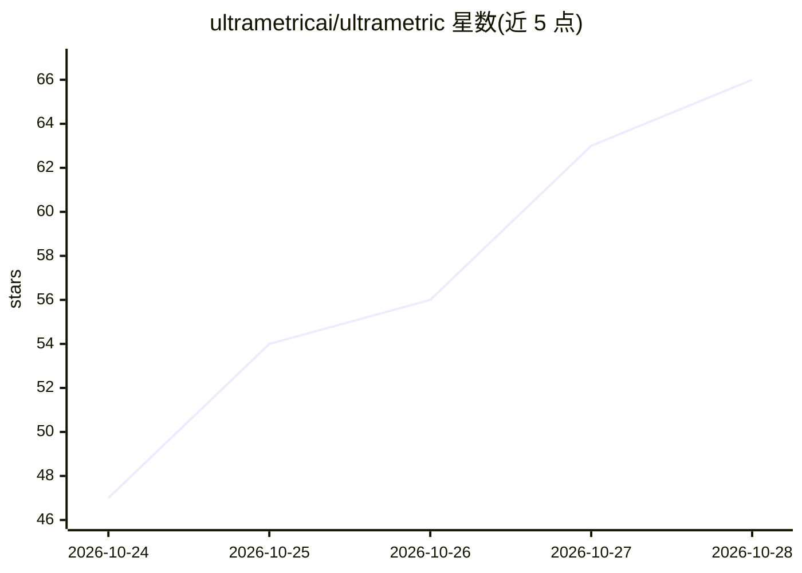

# ultrametricai/ultrametric

⭐ 66 · TypeScript · Apache-2.0 · 推送 2026-10-28 · [GitHub](https://github.com/ultrametricai/ultrametric) · [官网](https://ultrametric.ai) · 组织维护

**面向创始人的开源创业知识库：流程、法务、厂商评测与计算模块**

覆盖创业全程的开源仓库：按 agent/表单/人工路由并计时的创始人流程、按 AI 可访问性打分的厂商排行榜（银行、payroll、政府服务等）、可运行的创业计算模块（cap table、SAFE 转换、稀释、runway、期权税务、特拉华特许税等）、分辖区整理的法规条目、公开法律文档汇编、突发情况（传票、数据泄露）路由图与创始人经验库。模块代码在 lib/openstartup/，公式引用来源并在测试中回放公开例题；支持 14 个国家/地区，数据以 JSON Schema 校验，通过 PR 贡献并自动校验。

## 筛选速览

| 维度 | 判定 | 备注 |
|---|---|---|
| AI 角色 | `ai-knowledge` | 知识聚合/清单类 |
| 许可风险 | `permissive` | Apache-2.0 |
| 部署形态 | `library` | 以包/库形式分发 |
| 模型依赖 | — | README 未给出锁定关系 |
| 硬件要求 | — | 无带数字的原话,不猜 |
| 安装摩擦 | `low` | 无编译、无系统依赖或容器化 |
| 成熟度 | — | 结构信号不足 |

## 能力要点

- 厂商按 AI/agent 可访问性（API、CLI、MCP、computer use）打分排行
- 可运行的创业计算模块（cap table、SAFE、稀释、runway、税务）含来源引用与测试
- 创始人流程按 agent/表单/人工路由、计时并标注可撤销程度
- 分 14 个国家/地区整理法规、申报与厂商可用性

## 适用场景

- 查找哪些银行、payroll、法务厂商对 AI agent 最可接入
- 运行 SAFE 转换、稀释、runway 等标准创业计算
- 按国家查阅公司设立、税务申报的法规与流程
- 获取公开的法律文档模板与创始人经验阅读库

## 场景标签

`精选清单` · 领域:学习与行业

## 证据(README 行号)

> L11: ├── open-rankings/ per-market products, stories, evidence, verdicts
> L16: ├── open-lore/ founder advice and stories, who said it, the reading library
> L33: We've looked at all the tools and vendors needed for founders to start and operate their company. Vendors are then 

## 星数曲线

2026-10-24 47 → 2026-10-28 66（+19）

---
*卡片 v1 · prompt 1.4 · 生成 2026-10-24 · 置信度 mid · 依据 README sha `59759faf3c73` · [字段定义](../../DATASET.md)*
