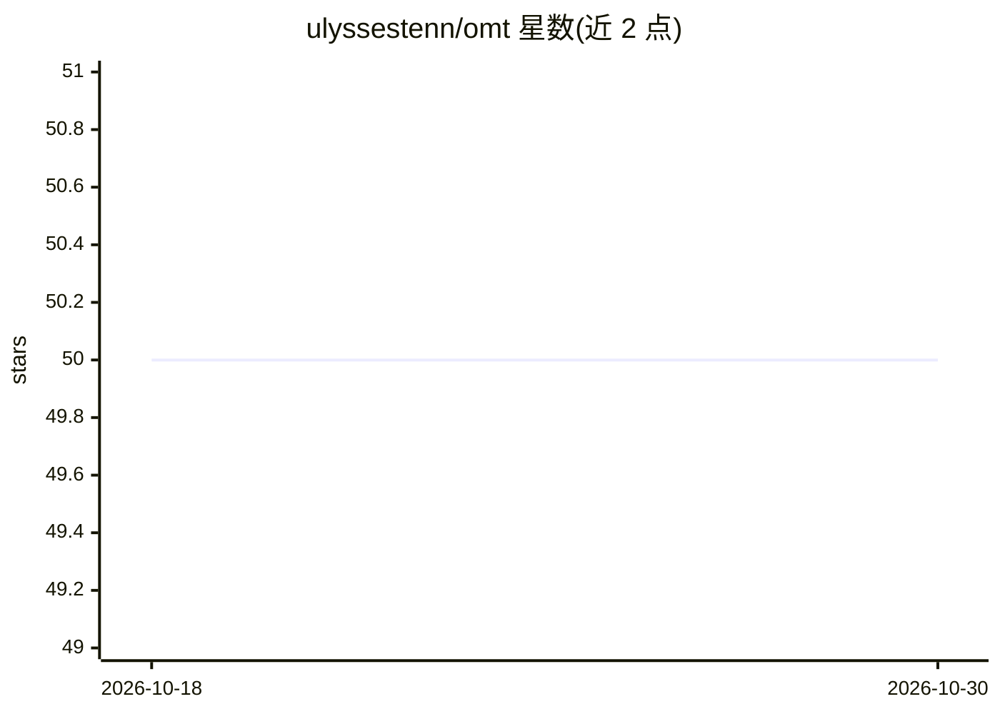

# ulyssestenn/omt

⭐ 50 · Python · MIT · 推送 2026-06-04 · [GitHub](https://github.com/ulyssestenn/omt) · 个人维护

**对比本地 Ollama 模型输出的零依赖 Python CLI**

单一脚本的命令行工具，将同一 prompt 对本地 Ollama 已安装模型重复运行多次，把每次回答连同 Ollama 运行元数据（token 数、耗时等）写入按 prompt 哈希分组的文件夹，便于模型间或同模型多次运行的并排对比。仅使用 Python 标准库，无需 pip 安装；支持交互式问答与命令行参数两种模式，可设置运行次数、温度、流式输出与从文件读取 prompt。要求本地运行 Ollama 并已拉取至少一个模型。

## 筛选速览

| 维度 | 判定 | 备注 |
|---|---|---|
| AI 角色 | `ai-ecosystem` | LLM/agent 周边工具 |
| 许可风险 | `permissive` | MIT |
| 部署形态 | `library` | 以包/库形式分发 |
| 模型依赖 | local-ok | 支持本地模型 |
| 硬件要求 | — | 无带数字的原话,不猜 |
| 安装摩擦 | `low` | 无编译、无系统依赖或容器化 |
| 成熟度 | — | 结构信号不足 |

## 能力要点

- 同一 prompt 对多个本地模型重复运行并保存结果
- 仅依赖 Python 标准库，无需安装第三方包
- 结果按 prompt 哈希分文件夹，记录 token 数与耗时等运行元数据
- 支持非交互式命令行参数，可脚本化

## 适用场景

- 为我的任务挑选合适的本地 Ollama 模型
- 对比同一模型多次生成的输出差异
- 留存每次运行的完整回答与元数据备查

## 场景标签

`模型评测` · 领域:评测与运维

## 证据(README 行号)

> L3: A small, dependency-free CLI for running the same prompt against your local
> L4: Ollama models and saving every response to disk — so you

## 星数曲线

2026-10-18 50 → 2026-10-30 50（+0）

---
*卡片 v1 · prompt 1.4 · 生成 2026-10-24 · 置信度 mid · 依据 README sha `a527f81b069e` · [字段定义](../../DATASET.md)*
